# Les dessins

Les 35 dessins sans emoji (bâtiments, arbres, bêtes, boutons), au plus 32×32 : le nom
du fichier est le nom du dessin dans le jeu (`js/ui/pixel-art.js`, `artHtml(nom)`).

## Télécharger

- Une image : l'ouvrir sur GitHub, puis le bouton « Download raw file ».
- Tout le dossier : sur la page du dépôt, « Code » → « Download ZIP ».

## Retoucher

Ces PNG sont les images du jeu, tels quels. Retoucher le fichier du dossier (pas son aperçu
agrandi de `apercu/`) dans un logiciel de pixel art (Aseprite, Piskel, LibreSprite…), sans
anticrénelage ni flou, le remettre à sa place sous le même nom, puis lancer
`python3 scripts/icones/build.py` : il refait la planche lue par le jeu (voir
[`docs/icones.md`](../../docs/icones.md)).

Le style : contour de 1 px dans une teinte très sombre de la couleur de l'objet (jamais du
noir pur), lumière en haut à gauche, 3 à 4 teintes par matière, pas d'anticrénelage.

> Galerie et `apercu/` refaits par `scripts/icones/build.py` : ne pas les modifier à la main.

| Dessin | Fichier |
|:---:|---|
| 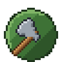 | [`axe-btn.png`](axe-btn.png) |
| 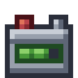 | [`b-batterie.png`](b-batterie.png) |
|  | [`b-champ.png`](b-champ.png) |
|  | [`b-cuisine.png`](b-cuisine.png) |
| 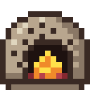 | [`b-four.png`](b-four.png) |
|  | [`b-frigo.png`](b-frigo.png) |
|  | [`b-moulin.png`](b-moulin.png) |
|  | [`b-panneau.png`](b-panneau.png) |
| 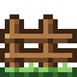 | [`b-paturage.png`](b-paturage.png) |
|  | [`b-pompe.png`](b-pompe.png) |
| 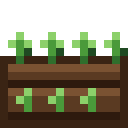 | [`b-potager.png`](b-potager.png) |
|  | [`b-poulailler.png`](b-poulailler.png) |
| 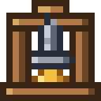 | [`b-presse.png`](b-presse.png) |
| 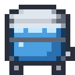 | [`b-reservoir.png`](b-reservoir.png) |
| 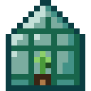 | [`b-serre.png`](b-serre.png) |
|  | [`b-silo.png`](b-silo.png) |
|  | [`b-verger.png`](b-verger.png) |
|  | [`carte-panneau_ville.png`](carte-panneau_ville.png) |
| 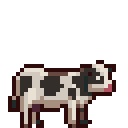 | [`cow.png`](cow.png) |
|  | [`egg.png`](egg.png) |
| 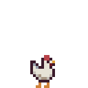 | [`hen.png`](hen.png) |
|  | [`hoe-btn.png`](hoe-btn.png) |
|  | [`pick-btn.png`](pick-btn.png) |
| 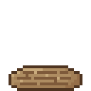 | [`plot-soil.png`](plot-soil.png) |
| 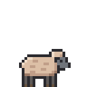 | [`sheep-shorn.png`](sheep-shorn.png) |
| 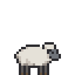 | [`sheep-wool.png`](sheep-wool.png) |
| 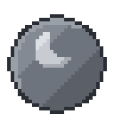 | [`sleep-off.png`](sleep-off.png) |
|  | [`sleep-on.png`](sleep-on.png) |
| 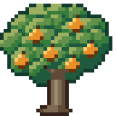 | [`tree-abricotier.png`](tree-abricotier.png) |
| 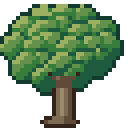 | [`tree-adult.png`](tree-adult.png) |
|  | [`tree-cerisier.png`](tree-cerisier.png) |
|  | [`tree-pecher.png`](tree-pecher.png) |
|  | [`tree-poirier.png`](tree-poirier.png) |
| 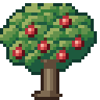 | [`tree-pommier.png`](tree-pommier.png) |
|  | [`tree-young.png`](tree-young.png) |
