# Les icônes d'emoji

Les 428 icônes de 16×16 qui remplacent les emojis à l'affichage. Une nouvelle icône :
déposer son PNG ici, l'ajouter à `icones.json` (emoji → fichier), puis lancer le script.

## Télécharger

- Une image : l'ouvrir sur GitHub, puis le bouton « Download raw file ».
- Tout le dossier : sur la page du dépôt, « Code » → « Download ZIP ».

## Retoucher

Ces PNG sont les images du jeu, tels quels. Retoucher le fichier du dossier (pas son aperçu
agrandi de `apercu/`) dans un logiciel de pixel art (Aseprite, Piskel, LibreSprite…), sans
anticrénelage ni flou, le remettre à sa place sous le même nom, puis lancer
`python3 scripts/icones/build.py` : il refait la planche lue par le jeu (voir
[`docs/icones.md`](../../docs/icones.md)).

Le style : contour de 1 px dans une teinte très sombre de la couleur de l'objet (jamais du
noir pur), lumière en haut à gauche, 3 à 4 teintes par matière, pas d'anticrénelage.

> Galerie et `apercu/` refaits par `scripts/icones/build.py` : ne pas les modifier à la main.

| Icône | Emoji | Fichier |
|:---:|:---:|---|
|  | ℹ | [`information_source.png`](information_source.png) |
|  | ⏱ | [`stopwatch.png`](stopwatch.png) |
|  | ⏳ | [`hourglass_with_flowing_sand.png`](hourglass_with_flowing_sand.png) |
|  | ☀ | [`black_sun_with_rays.png`](black_sun_with_rays.png) |
|  | ☕ | [`hot_beverage.png`](hot_beverage.png) |
|  | ☕‍🍫 | [`hot_beverage+chocolate_bar.png`](hot_beverage+chocolate_bar.png) |
|  | ☕‍🔥 | [`hot_beverage+fire.png`](hot_beverage+fire.png) |
| 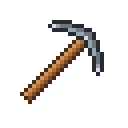 | ⚒ | [`hammer_and_pick.png`](hammer_and_pick.png) |
|  | ⚙ | [`gear.png`](gear.png) |
|  | ⚙‍🌾 | [`gear+ear_of_rice.png`](gear+ear_of_rice.png) |
|  | ⚠ | [`warning_sign.png`](warning_sign.png) |
|  | ⚡ | [`high_voltage_sign.png`](high_voltage_sign.png) |
| 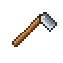 | ⛏ | [`pick.png`](pick.png) |
|  | ⛑‍💡 | [`helmet_with_white_cross+electric_light_bulb.png`](helmet_with_white_cross+electric_light_bulb.png) |
|  | ⛔ | [`no_entry.png`](no_entry.png) |
|  | ⛲ | [`fountain.png`](fountain.png) |
|  | ⛺ | [`tent.png`](tent.png) |
|  | ✂ | [`black_scissors.png`](black_scissors.png) |
|  | ✅ | [`white_heavy_check_mark.png`](white_heavy_check_mark.png) |
|  | ✉ | [`envelope.png`](envelope.png) |
| 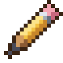 | ✏ | [`pencil.png`](pencil.png) |
|  | ✨ | [`sparkles.png`](sparkles.png) |
| 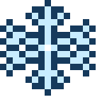 | ❄ | [`snowflake.png`](snowflake.png) |
|  | ❌ | [`cross_mark.png`](cross_mark.png) |
|  | ❤ | [`heavy_black_heart.png`](heavy_black_heart.png) |
|  | ➕ | [`heavy_plus_sign.png`](heavy_plus_sign.png) |
|  | ➰ | [`curly_loop.png`](curly_loop.png) |
|  | ⬜ | [`white_large_square.png`](white_large_square.png) |
|  | ⭐‍🌊 | [`white_medium_star+water_wave.png`](white_medium_star+water_wave.png) |
|  | 🌅 | [`sunrise.png`](sunrise.png) |
|  | 🌑 | [`new_moon_symbol.png`](new_moon_symbol.png) |
|  | 🌒 | [`waxing_crescent_moon_symbol.png`](waxing_crescent_moon_symbol.png) |
|  | 🌕 | [`full_moon_symbol.png`](full_moon_symbol.png) |
|  | 🌘 | [`waning_crescent_moon_symbol.png`](waning_crescent_moon_symbol.png) |
| 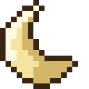 | 🌙 | [`crescent_moon.png`](crescent_moon.png) |
|  | 🌧 | [`cloud_with_rain.png`](cloud_with_rain.png) |
|  | 🌰 | [`chestnut.png`](chestnut.png) |
|  | 🌱 | [`seedling.png`](seedling.png) |
|  | 🌱‍🌻 | [`seedling+sunflower.png`](seedling+sunflower.png) |
| 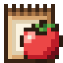 | 🌱‍🍅 | [`seedling+tomato.png`](seedling+tomato.png) |
| 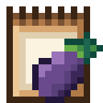 | 🌱‍🍆 | [`seedling+aubergine.png`](seedling+aubergine.png) |
|  | 🌱‍🍎 | [`seedling+red_apple.png`](seedling+red_apple.png) |
|  | 🌱‍🍐 | [`seedling+pear.png`](seedling+pear.png) |
|  | 🌱‍🍑 | [`seedling+peach.png`](seedling+peach.png) |
|  | 🌱‍🍒 | [`seedling+cherries.png`](seedling+cherries.png) |
| 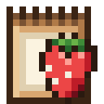 | 🌱‍🍓 | [`seedling+strawberry.png`](seedling+strawberry.png) |
|  | 🌱‍🟠 | [`seedling+large_orange_circle.png`](seedling+large_orange_circle.png) |
|  | 🌱‍🥒 | [`seedling+cucumber.png`](seedling+cucumber.png) |
|  | 🌱‍🥕 | [`seedling+carrot.png`](seedling+carrot.png) |
| 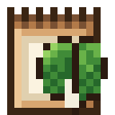 | 🌱‍🥬 | [`seedling+leafy_green.png`](seedling+leafy_green.png) |
| 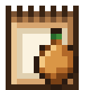 | 🌱‍🧅 | [`seedling+onion.png`](seedling+onion.png) |
| 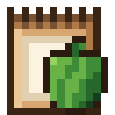 | 🌱‍🫑 | [`seedling+bell_pepper.png`](seedling+bell_pepper.png) |
|  | 🌲‍🟤 | [`evergreen_tree+large_brown_circle.png`](evergreen_tree+large_brown_circle.png) |
| 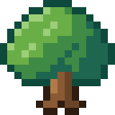 | 🌳 | [`deciduous_tree.png`](deciduous_tree.png) |
|  | 🌳‍🟤 | [`deciduous_tree+large_brown_circle.png`](deciduous_tree+large_brown_circle.png) |
|  | 🌶 | [`hot_pepper.png`](hot_pepper.png) |
|  | 🌻 | [`sunflower.png`](sunflower.png) |
| 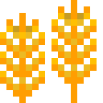 | 🌾 | [`ear_of_rice.png`](ear_of_rice.png) |
|  | 🌾‍⚙ | [`ear_of_rice+gear.png`](ear_of_rice+gear.png) |
| 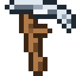 | 🌾‍🔪 | [`ear_of_rice+hocho.png`](ear_of_rice+hocho.png) |
|  | 🌾‍🛶 | [`ear_of_rice+canoe.png`](ear_of_rice+canoe.png) |
|  | 🌾‍🪜 | [`ear_of_rice+ladder.png`](ear_of_rice+ladder.png) |
| 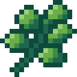 | 🌿 | [`herb.png`](herb.png) |
| 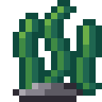 | 🌿‍🌊 | [`herb+water_wave.png`](herb+water_wave.png) |
|  | 🌿‍🏔 | [`herb+snow_capped_mountain.png`](herb+snow_capped_mountain.png) |
|  | 🍂 | [`fallen_leaf.png`](fallen_leaf.png) |
|  | 🍄 | [`mushroom.png`](mushroom.png) |
|  | 🍄‍✨ | [`mushroom+sparkles.png`](mushroom+sparkles.png) |
| 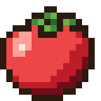 | 🍅 | [`tomato.png`](tomato.png) |
| 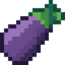 | 🍆 | [`aubergine.png`](aubergine.png) |
| 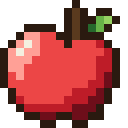 | 🍎 | [`red_apple.png`](red_apple.png) |
| 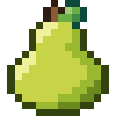 | 🍐 | [`pear.png`](pear.png) |
|  | 🍑 | [`peach.png`](peach.png) |
|  | 🍑‍🟠 | [`peach+large_orange_circle.png`](peach+large_orange_circle.png) |
|  | 🍒 | [`cherries.png`](cherries.png) |
| 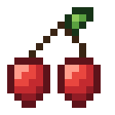 | 🍒‍🌸 | [`cherries+cherry_blossom.png`](cherries+cherry_blossom.png) |
| 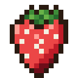 | 🍓 | [`strawberry.png`](strawberry.png) |
|  | 🍔 | [`hamburger.png`](hamburger.png) |
|  | 🍕 | [`slice_of_pizza.png`](slice_of_pizza.png) |
|  | 🍖 | [`meat_on_bone.png`](meat_on_bone.png) |
| 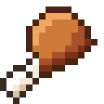 | 🍗 | [`poultry_leg.png`](poultry_leg.png) |
|  | 🍚 | [`cooked_rice.png`](cooked_rice.png) |
|  | 🍚‍🥛 | [`cooked_rice+glass_of_milk.png`](cooked_rice+glass_of_milk.png) |
|  | 🍞 | [`bread.png`](bread.png) |
| 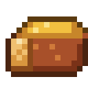 | 🍞‍🍯 | [`bread+honey_pot.png`](bread+honey_pot.png) |
|  | 🍟 | [`french_fries.png`](french_fries.png) |
| 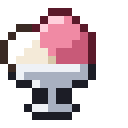 | 🍨 | [`ice_cream.png`](ice_cream.png) |
|  | 🍫 | [`chocolate_bar.png`](chocolate_bar.png) |
|  | 🍬 | [`candy.png`](candy.png) |
|  | 🍮 | [`custard.png`](custard.png) |
|  | 🍯 | [`honey_pot.png`](honey_pot.png) |
|  | 🍰 | [`shortcake.png`](shortcake.png) |
| 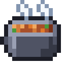 | 🍲 | [`pot_of_food.png`](pot_of_food.png) |
|  | 🍲‍🥕 | [`pot_of_food+carrot.png`](pot_of_food+carrot.png) |
|  | 🍳 | [`cooking.png`](cooking.png) |
|  | 🍳‍🍄 | [`cooking+mushroom.png`](cooking+mushroom.png) |
|  | 🍳‍🥚 | [`cooking+egg.png`](cooking+egg.png) |
|  | 🍺 | [`beer_mug.png`](beer_mug.png) |
|  | 🍽 | [`fork_and_knife_with_plate.png`](fork_and_knife_with_plate.png) |
|  | 🎉 | [`party_popper.png`](party_popper.png) |
|  | 🎍 | [`pine_decoration.png`](pine_decoration.png) |
|  | 🎒‍🌿 | [`school_satchel+herb.png`](school_satchel+herb.png) |
|  | 🎒‍🧶 | [`school_satchel+ball_of_yarn.png`](school_satchel+ball_of_yarn.png) |
|  | 🎛 | [`control_knobs.png`](control_knobs.png) |
| 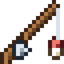 | 🎣 | [`fishing_pole_and_fish.png`](fishing_pole_and_fish.png) |
|  | 🎬 | [`clapper_board.png`](clapper_board.png) |
|  | 🎭 | [`performing_arts.png`](performing_arts.png) |
|  | 🏅 | [`sports_medal.png`](sports_medal.png) |
|  | 🏆 | [`trophy.png`](trophy.png) |
|  | 🏗 | [`building_construction.png`](building_construction.png) |
|  | 🏘 | [`house_buildings.png`](house_buildings.png) |
|  | 🏙 | [`cityscape.png`](cityscape.png) |
|  | 🏚 | [`derelict_house_building.png`](derelict_house_building.png) |
|  | 🏠 | [`house_building.png`](house_building.png) |
|  | 🏡 | [`house_with_garden.png`](house_with_garden.png) |
|  | 🏪 | [`convenience_store.png`](convenience_store.png) |
|  | 🏮 | [`izakaya_lantern.png`](izakaya_lantern.png) |
|  | 🏺 | [`amphora.png`](amphora.png) |
| 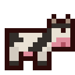 | 🐄 | [`cow.png`](cow.png) |
|  | 🐌 | [`snail.png`](snail.png) |
|  | 🐑 | [`sheep.png`](sheep.png) |
|  | 🐔 | [`chicken.png`](chicken.png) |
| 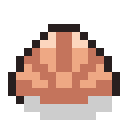 | 🐚 | [`spiral_shell.png`](spiral_shell.png) |
|  | 🐝 | [`honeybee.png`](honeybee.png) |
|  | 🐟 | [`fish.png`](fish.png) |
| 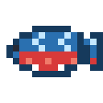 | 🐟‍❄ | [`fish+snowflake.png`](fish+snowflake.png) |
| 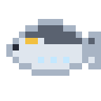 | 🐟‍⭐ | [`fish+white_medium_star.png`](fish+white_medium_star.png) |
|  | 🐟‍🌀 | [`fish+cyclone.png`](fish+cyclone.png) |
|  | 🐟‍🌈 | [`fish+rainbow.png`](fish+rainbow.png) |
|  | 🐟‍🌊 | [`fish+water_wave.png`](fish+water_wave.png) |
| 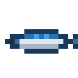 | 🐟‍💧 | [`fish+droplet.png`](fish+droplet.png) |
|  | 🐟‍🔥 | [`fish+fire.png`](fish+fire.png) |
|  | 🐟‍🔶 | [`fish+large_orange_diamond.png`](fish+large_orange_diamond.png) |
|  | 🐟‍🥟 | [`fish+dumpling.png`](fish+dumpling.png) |
|  | 🐟‍🦷 | [`fish+tooth.png`](fish+tooth.png) |
| 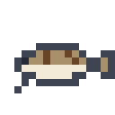 | 🐟‍🪨 | [`fish+rock.png`](fish+rock.png) |
|  | 🐱 | [`cat_face.png`](cat_face.png) |
| 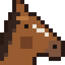 | 🐴 | [`horse_face.png`](horse_face.png) |
|  | 🐶 | [`dog_face.png`](dog_face.png) |
|  | 🐾 | [`paw_prints.png`](paw_prints.png) |
|  | 👋 | [`waving_hand_sign.png`](waving_hand_sign.png) |
|  | 👒‍🌾 | [`womans_hat+ear_of_rice.png`](womans_hat+ear_of_rice.png) |
|  | 👖‍🔧 | [`jeans+wrench.png`](jeans+wrench.png) |
|  | 👢‍🟫 | [`womans_boots+large_brown_square.png`](womans_boots+large_brown_square.png) |
|  | 👦 | [`boy.png`](boy.png) |
|  | 👦‍👱 | [`boy+person_with_blond_hair.png`](boy+person_with_blond_hair.png) |
|  | 👦‍🦰 | [`boy+emoji_component_red_hair.png`](boy+emoji_component_red_hair.png) |
|  | 👦‍🦱 | [`boy+emoji_component_curly_hair.png`](boy+emoji_component_curly_hair.png) |
|  | 👦‍🧢 | [`boy+billed_cap.png`](boy+billed_cap.png) |
|  | 👦🏻 | [`boy_skin_type_1_2.png`](boy_skin_type_1_2.png) |
|  | 👦🏻‍👱 | [`boy_skin_type_1_2+person_with_blond_hair.png`](boy_skin_type_1_2+person_with_blond_hair.png) |
|  | 👦🏻‍🦰 | [`boy_skin_type_1_2+emoji_component_red_hair.png`](boy_skin_type_1_2+emoji_component_red_hair.png) |
|  | 👦🏻‍🦱 | [`boy_skin_type_1_2+emoji_component_curly_hair.png`](boy_skin_type_1_2+emoji_component_curly_hair.png) |
|  | 👦🏻‍🧢 | [`boy_skin_type_1_2+billed_cap.png`](boy_skin_type_1_2+billed_cap.png) |
|  | 👦🏼 | [`boy_skin_type_3.png`](boy_skin_type_3.png) |
|  | 👦🏼‍👱 | [`boy_skin_type_3+person_with_blond_hair.png`](boy_skin_type_3+person_with_blond_hair.png) |
|  | 👦🏼‍🦰 | [`boy_skin_type_3+emoji_component_red_hair.png`](boy_skin_type_3+emoji_component_red_hair.png) |
|  | 👦🏼‍🦱 | [`boy_skin_type_3+emoji_component_curly_hair.png`](boy_skin_type_3+emoji_component_curly_hair.png) |
|  | 👦🏼‍🧢 | [`boy_skin_type_3+billed_cap.png`](boy_skin_type_3+billed_cap.png) |
|  | 👦🏽 | [`boy_skin_type_4.png`](boy_skin_type_4.png) |
|  | 👦🏽‍👱 | [`boy_skin_type_4+person_with_blond_hair.png`](boy_skin_type_4+person_with_blond_hair.png) |
|  | 👦🏽‍🦰 | [`boy_skin_type_4+emoji_component_red_hair.png`](boy_skin_type_4+emoji_component_red_hair.png) |
|  | 👦🏽‍🦱 | [`boy_skin_type_4+emoji_component_curly_hair.png`](boy_skin_type_4+emoji_component_curly_hair.png) |
|  | 👦🏽‍🧢 | [`boy_skin_type_4+billed_cap.png`](boy_skin_type_4+billed_cap.png) |
|  | 👦🏾 | [`boy_skin_type_5.png`](boy_skin_type_5.png) |
|  | 👦🏾‍👱 | [`boy_skin_type_5+person_with_blond_hair.png`](boy_skin_type_5+person_with_blond_hair.png) |
|  | 👦🏾‍🦰 | [`boy_skin_type_5+emoji_component_red_hair.png`](boy_skin_type_5+emoji_component_red_hair.png) |
|  | 👦🏾‍🦱 | [`boy_skin_type_5+emoji_component_curly_hair.png`](boy_skin_type_5+emoji_component_curly_hair.png) |
|  | 👦🏾‍🧢 | [`boy_skin_type_5+billed_cap.png`](boy_skin_type_5+billed_cap.png) |
|  | 👦🏿 | [`boy_skin_type_6.png`](boy_skin_type_6.png) |
|  | 👦🏿‍👱 | [`boy_skin_type_6+person_with_blond_hair.png`](boy_skin_type_6+person_with_blond_hair.png) |
|  | 👦🏿‍🦰 | [`boy_skin_type_6+emoji_component_red_hair.png`](boy_skin_type_6+emoji_component_red_hair.png) |
|  | 👦🏿‍🦱 | [`boy_skin_type_6+emoji_component_curly_hair.png`](boy_skin_type_6+emoji_component_curly_hair.png) |
|  | 👦🏿‍🧢 | [`boy_skin_type_6+billed_cap.png`](boy_skin_type_6+billed_cap.png) |
|  | 👧 | [`girl.png`](girl.png) |
|  | 👧‍👱 | [`girl+person_with_blond_hair.png`](girl+person_with_blond_hair.png) |
|  | 👧‍🦰 | [`girl+emoji_component_red_hair.png`](girl+emoji_component_red_hair.png) |
|  | 👧‍🦱 | [`girl+emoji_component_curly_hair.png`](girl+emoji_component_curly_hair.png) |
|  | 👧‍🧢 | [`girl+billed_cap.png`](girl+billed_cap.png) |
|  | 👧🏻 | [`girl_skin_type_1_2.png`](girl_skin_type_1_2.png) |
|  | 👧🏻‍👱 | [`girl_skin_type_1_2+person_with_blond_hair.png`](girl_skin_type_1_2+person_with_blond_hair.png) |
|  | 👧🏻‍🦰 | [`girl_skin_type_1_2+emoji_component_red_hair.png`](girl_skin_type_1_2+emoji_component_red_hair.png) |
|  | 👧🏻‍🦱 | [`girl_skin_type_1_2+emoji_component_curly_hair.png`](girl_skin_type_1_2+emoji_component_curly_hair.png) |
|  | 👧🏻‍🧢 | [`girl_skin_type_1_2+billed_cap.png`](girl_skin_type_1_2+billed_cap.png) |
|  | 👧🏼 | [`girl_skin_type_3.png`](girl_skin_type_3.png) |
|  | 👧🏼‍👱 | [`girl_skin_type_3+person_with_blond_hair.png`](girl_skin_type_3+person_with_blond_hair.png) |
|  | 👧🏼‍🦰 | [`girl_skin_type_3+emoji_component_red_hair.png`](girl_skin_type_3+emoji_component_red_hair.png) |
|  | 👧🏼‍🦱 | [`girl_skin_type_3+emoji_component_curly_hair.png`](girl_skin_type_3+emoji_component_curly_hair.png) |
|  | 👧🏼‍🧢 | [`girl_skin_type_3+billed_cap.png`](girl_skin_type_3+billed_cap.png) |
|  | 👧🏽 | [`girl_skin_type_4.png`](girl_skin_type_4.png) |
|  | 👧🏽‍👱 | [`girl_skin_type_4+person_with_blond_hair.png`](girl_skin_type_4+person_with_blond_hair.png) |
|  | 👧🏽‍🦰 | [`girl_skin_type_4+emoji_component_red_hair.png`](girl_skin_type_4+emoji_component_red_hair.png) |
|  | 👧🏽‍🦱 | [`girl_skin_type_4+emoji_component_curly_hair.png`](girl_skin_type_4+emoji_component_curly_hair.png) |
|  | 👧🏽‍🧢 | [`girl_skin_type_4+billed_cap.png`](girl_skin_type_4+billed_cap.png) |
|  | 👧🏾 | [`girl_skin_type_5.png`](girl_skin_type_5.png) |
|  | 👧🏾‍👱 | [`girl_skin_type_5+person_with_blond_hair.png`](girl_skin_type_5+person_with_blond_hair.png) |
|  | 👧🏾‍🦰 | [`girl_skin_type_5+emoji_component_red_hair.png`](girl_skin_type_5+emoji_component_red_hair.png) |
|  | 👧🏾‍🦱 | [`girl_skin_type_5+emoji_component_curly_hair.png`](girl_skin_type_5+emoji_component_curly_hair.png) |
|  | 👧🏾‍🧢 | [`girl_skin_type_5+billed_cap.png`](girl_skin_type_5+billed_cap.png) |
|  | 👧🏿 | [`girl_skin_type_6.png`](girl_skin_type_6.png) |
|  | 👧🏿‍👱 | [`girl_skin_type_6+person_with_blond_hair.png`](girl_skin_type_6+person_with_blond_hair.png) |
|  | 👧🏿‍🦰 | [`girl_skin_type_6+emoji_component_red_hair.png`](girl_skin_type_6+emoji_component_red_hair.png) |
|  | 👧🏿‍🦱 | [`girl_skin_type_6+emoji_component_curly_hair.png`](girl_skin_type_6+emoji_component_curly_hair.png) |
|  | 👧🏿‍🧢 | [`girl_skin_type_6+billed_cap.png`](girl_skin_type_6+billed_cap.png) |
|  | 👨 | [`man.png`](man.png) |
|  | 👨‍👩‍👧‍👦 | [`man+woman+girl+boy.png`](man+woman+girl+boy.png) |
|  | 👨‍👱 | [`man+person_with_blond_hair.png`](man+person_with_blond_hair.png) |
|  | 👨‍🦰 | [`man+emoji_component_red_hair.png`](man+emoji_component_red_hair.png) |
|  | 👨‍🦱 | [`man+emoji_component_curly_hair.png`](man+emoji_component_curly_hair.png) |
|  | 👨‍🦳 | [`man+emoji_component_white_hair.png`](man+emoji_component_white_hair.png) |
|  | 👨🏻 | [`man_skin_type_1_2.png`](man_skin_type_1_2.png) |
|  | 👨🏻‍👱 | [`man_skin_type_1_2+person_with_blond_hair.png`](man_skin_type_1_2+person_with_blond_hair.png) |
|  | 👨🏻‍🦰 | [`man_skin_type_1_2+emoji_component_red_hair.png`](man_skin_type_1_2+emoji_component_red_hair.png) |
|  | 👨🏻‍🦱 | [`man_skin_type_1_2+emoji_component_curly_hair.png`](man_skin_type_1_2+emoji_component_curly_hair.png) |
|  | 👨🏻‍🦳 | [`man_skin_type_1_2+emoji_component_white_hair.png`](man_skin_type_1_2+emoji_component_white_hair.png) |
|  | 👨🏼 | [`man_skin_type_3.png`](man_skin_type_3.png) |
|  | 👨🏼‍👱 | [`man_skin_type_3+person_with_blond_hair.png`](man_skin_type_3+person_with_blond_hair.png) |
|  | 👨🏼‍🦰 | [`man_skin_type_3+emoji_component_red_hair.png`](man_skin_type_3+emoji_component_red_hair.png) |
|  | 👨🏼‍🦱 | [`man_skin_type_3+emoji_component_curly_hair.png`](man_skin_type_3+emoji_component_curly_hair.png) |
|  | 👨🏼‍🦳 | [`man_skin_type_3+emoji_component_white_hair.png`](man_skin_type_3+emoji_component_white_hair.png) |
|  | 👨🏽 | [`man_skin_type_4.png`](man_skin_type_4.png) |
|  | 👨🏽‍👱 | [`man_skin_type_4+person_with_blond_hair.png`](man_skin_type_4+person_with_blond_hair.png) |
|  | 👨🏽‍🦰 | [`man_skin_type_4+emoji_component_red_hair.png`](man_skin_type_4+emoji_component_red_hair.png) |
|  | 👨🏽‍🦱 | [`man_skin_type_4+emoji_component_curly_hair.png`](man_skin_type_4+emoji_component_curly_hair.png) |
|  | 👨🏽‍🦳 | [`man_skin_type_4+emoji_component_white_hair.png`](man_skin_type_4+emoji_component_white_hair.png) |
|  | 👨🏾 | [`man_skin_type_5.png`](man_skin_type_5.png) |
|  | 👨🏾‍👱 | [`man_skin_type_5+person_with_blond_hair.png`](man_skin_type_5+person_with_blond_hair.png) |
|  | 👨🏾‍🦰 | [`man_skin_type_5+emoji_component_red_hair.png`](man_skin_type_5+emoji_component_red_hair.png) |
|  | 👨🏾‍🦱 | [`man_skin_type_5+emoji_component_curly_hair.png`](man_skin_type_5+emoji_component_curly_hair.png) |
|  | 👨🏾‍🦳 | [`man_skin_type_5+emoji_component_white_hair.png`](man_skin_type_5+emoji_component_white_hair.png) |
|  | 👨🏿 | [`man_skin_type_6.png`](man_skin_type_6.png) |
|  | 👨🏿‍👱 | [`man_skin_type_6+person_with_blond_hair.png`](man_skin_type_6+person_with_blond_hair.png) |
|  | 👨🏿‍🦰 | [`man_skin_type_6+emoji_component_red_hair.png`](man_skin_type_6+emoji_component_red_hair.png) |
|  | 👨🏿‍🦱 | [`man_skin_type_6+emoji_component_curly_hair.png`](man_skin_type_6+emoji_component_curly_hair.png) |
|  | 👨🏿‍🦳 | [`man_skin_type_6+emoji_component_white_hair.png`](man_skin_type_6+emoji_component_white_hair.png) |
|  | 👩 | [`woman.png`](woman.png) |
|  | 👩‍👱 | [`woman+person_with_blond_hair.png`](woman+person_with_blond_hair.png) |
|  | 👩‍🦰 | [`woman+emoji_component_red_hair.png`](woman+emoji_component_red_hair.png) |
|  | 👩‍🦱 | [`woman+emoji_component_curly_hair.png`](woman+emoji_component_curly_hair.png) |
|  | 👩‍🦳 | [`woman+emoji_component_white_hair.png`](woman+emoji_component_white_hair.png) |
|  | 👩🏻 | [`woman_skin_type_1_2.png`](woman_skin_type_1_2.png) |
|  | 👩🏻‍👱 | [`woman_skin_type_1_2+person_with_blond_hair.png`](woman_skin_type_1_2+person_with_blond_hair.png) |
|  | 👩🏻‍🦰 | [`woman_skin_type_1_2+emoji_component_red_hair.png`](woman_skin_type_1_2+emoji_component_red_hair.png) |
|  | 👩🏻‍🦱 | [`woman_skin_type_1_2+emoji_component_curly_hair.png`](woman_skin_type_1_2+emoji_component_curly_hair.png) |
|  | 👩🏻‍🦳 | [`woman_skin_type_1_2+emoji_component_white_hair.png`](woman_skin_type_1_2+emoji_component_white_hair.png) |
|  | 👩🏼 | [`woman_skin_type_3.png`](woman_skin_type_3.png) |
|  | 👩🏼‍👱 | [`woman_skin_type_3+person_with_blond_hair.png`](woman_skin_type_3+person_with_blond_hair.png) |
|  | 👩🏼‍🦰 | [`woman_skin_type_3+emoji_component_red_hair.png`](woman_skin_type_3+emoji_component_red_hair.png) |
|  | 👩🏼‍🦱 | [`woman_skin_type_3+emoji_component_curly_hair.png`](woman_skin_type_3+emoji_component_curly_hair.png) |
|  | 👩🏼‍🦳 | [`woman_skin_type_3+emoji_component_white_hair.png`](woman_skin_type_3+emoji_component_white_hair.png) |
|  | 👩🏽 | [`woman_skin_type_4.png`](woman_skin_type_4.png) |
|  | 👩🏽‍👱 | [`woman_skin_type_4+person_with_blond_hair.png`](woman_skin_type_4+person_with_blond_hair.png) |
|  | 👩🏽‍🦰 | [`woman_skin_type_4+emoji_component_red_hair.png`](woman_skin_type_4+emoji_component_red_hair.png) |
|  | 👩🏽‍🦱 | [`woman_skin_type_4+emoji_component_curly_hair.png`](woman_skin_type_4+emoji_component_curly_hair.png) |
|  | 👩🏽‍🦳 | [`woman_skin_type_4+emoji_component_white_hair.png`](woman_skin_type_4+emoji_component_white_hair.png) |
|  | 👩🏾 | [`woman_skin_type_5.png`](woman_skin_type_5.png) |
|  | 👩🏾‍👱 | [`woman_skin_type_5+person_with_blond_hair.png`](woman_skin_type_5+person_with_blond_hair.png) |
|  | 👩🏾‍🦰 | [`woman_skin_type_5+emoji_component_red_hair.png`](woman_skin_type_5+emoji_component_red_hair.png) |
|  | 👩🏾‍🦱 | [`woman_skin_type_5+emoji_component_curly_hair.png`](woman_skin_type_5+emoji_component_curly_hair.png) |
|  | 👩🏾‍🦳 | [`woman_skin_type_5+emoji_component_white_hair.png`](woman_skin_type_5+emoji_component_white_hair.png) |
|  | 👩🏿 | [`woman_skin_type_6.png`](woman_skin_type_6.png) |
|  | 👩🏿‍👱 | [`woman_skin_type_6+person_with_blond_hair.png`](woman_skin_type_6+person_with_blond_hair.png) |
|  | 👩🏿‍🦰 | [`woman_skin_type_6+emoji_component_red_hair.png`](woman_skin_type_6+emoji_component_red_hair.png) |
|  | 👩🏿‍🦱 | [`woman_skin_type_6+emoji_component_curly_hair.png`](woman_skin_type_6+emoji_component_curly_hair.png) |
|  | 👩🏿‍🦳 | [`woman_skin_type_6+emoji_component_white_hair.png`](woman_skin_type_6+emoji_component_white_hair.png) |
| 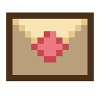 | 💌 | [`love_letter.png`](love_letter.png) |
|  | 💎 | [`gem_stone.png`](gem_stone.png) |
|  | 💎‍🟣 | [`gem_stone+large_purple_circle.png`](gem_stone+large_purple_circle.png) |
| 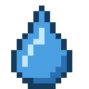 | 💧 | [`droplet.png`](droplet.png) |
|  | 💬 | [`speech_balloon.png`](speech_balloon.png) |
|  | 💰 | [`money_bag.png`](money_bag.png) |
|  | 💻 | [`personal_computer.png`](personal_computer.png) |
|  | 📅 | [`calendar.png`](calendar.png) |
|  | 📋 | [`clipboard.png`](clipboard.png) |
|  | 📓 | [`notebook.png`](notebook.png) |
|  | 📖 | [`open_book.png`](open_book.png) |
|  | 📚 | [`books.png`](books.png) |
|  | 📜 | [`scroll.png`](scroll.png) |
|  | 📟 | [`pager.png`](pager.png) |
|  | 📦 | [`package.png`](package.png) |
|  | 📬 | [`open_mailbox_with_raised_flag.png`](open_mailbox_with_raised_flag.png) |
|  | 📭 | [`open_mailbox_with_lowered_flag.png`](open_mailbox_with_lowered_flag.png) |
|  | 🔁 | [`clockwise_rightwards_and_leftwards_open_circle_arrows.png`](clockwise_rightwards_and_leftwards_open_circle_arrows.png) |
| 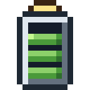 | 🔋 | [`battery.png`](battery.png) |
| 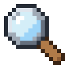 | 🔎 | [`right_pointing_magnifying_glass.png`](right_pointing_magnifying_glass.png) |
|  | 🔒 | [`lock.png`](lock.png) |
|  | 🔥 | [`fire.png`](fire.png) |
|  | 🔦 | [`electric_torch.png`](electric_torch.png) |
|  | 🔧 | [`wrench.png`](wrench.png) |
|  | 🔨 | [`hammer.png`](hammer.png) |
|  | 🔬 | [`microscope.png`](microscope.png) |
|  | 🔻 | [`down_pointing_red_triangle.png`](down_pointing_red_triangle.png) |
|  | 🕐 | [`clock_face_one_oclock.png`](clock_face_one_oclock.png) |
| 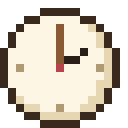 | 🕑 | [`clock_face_two_oclock.png`](clock_face_two_oclock.png) |
|  | 🕒 | [`clock_face_three_oclock.png`](clock_face_three_oclock.png) |
|  | 🕓 | [`clock_face_four_oclock.png`](clock_face_four_oclock.png) |
|  | 🕔 | [`clock_face_five_oclock.png`](clock_face_five_oclock.png) |
|  | 🕕 | [`clock_face_six_oclock.png`](clock_face_six_oclock.png) |
|  | 🕖 | [`clock_face_seven_oclock.png`](clock_face_seven_oclock.png) |
|  | 🕗 | [`clock_face_eight_oclock.png`](clock_face_eight_oclock.png) |
| 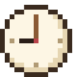 | 🕘 | [`clock_face_nine_oclock.png`](clock_face_nine_oclock.png) |
|  | 🕙 | [`clock_face_ten_oclock.png`](clock_face_ten_oclock.png) |
|  | 🕚 | [`clock_face_eleven_oclock.png`](clock_face_eleven_oclock.png) |
|  | 🕛 | [`clock_face_twelve_oclock.png`](clock_face_twelve_oclock.png) |
|  | 🕯 | [`candle.png`](candle.png) |
|  | 🕳 | [`hole.png`](hole.png) |
|  | 🕹 | [`joystick.png`](joystick.png) |
|  | 🗃 | [`card_file_box.png`](card_file_box.png) |
|  | 🗑 | [`wastebasket.png`](wastebasket.png) |
|  | 🗺 | [`world_map.png`](world_map.png) |
|  | 😊 | [`smiling_face_with_smiling_eyes.png`](smiling_face_with_smiling_eyes.png) |
|  | 😴 | [`sleeping_face.png`](sleeping_face.png) |
|  | 🙂 | [`slightly_smiling_face.png`](slightly_smiling_face.png) |
|  | 🚆 | [`train.png`](train.png) |
|  | 🚌 | [`bus.png`](bus.png) |
|  | 🚧 | [`construction_sign.png`](construction_sign.png) |
|  | 🚪 | [`door.png`](door.png) |
|  | 🚪‍⬛ | [`door+black_large_square.png`](door+black_large_square.png) |
|  | 🚪‍⬜ | [`door+white_large_square.png`](door+white_large_square.png) |
|  | 🚪‍🟤 | [`door+large_brown_circle.png`](door+large_brown_circle.png) |
| 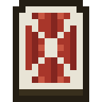 | 🚪‍🟥 | [`door+large_red_square.png`](door+large_red_square.png) |
|  | 🚪‍🟦 | [`door+large_blue_square.png`](door+large_blue_square.png) |
|  | 🚪‍🟩 | [`door+large_green_square.png`](door+large_green_square.png) |
|  | 🚪‍🪟 | [`door+window.png`](door+window.png) |
|  | 🚿 | [`shower.png`](shower.png) |
| 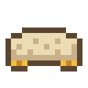 | 🛏 | [`bed.png`](bed.png) |
|  | 🛒 | [`shopping_trolley.png`](shopping_trolley.png) |
|  | 🛖 | [`hut.png`](hut.png) |
|  | 🛝 | [`playground_slide.png`](playground_slide.png) |
|  | 🛠 | [`hammer_and_wrench.png`](hammer_and_wrench.png) |
|  | 🛢 | [`oil_drum.png`](oil_drum.png) |
| 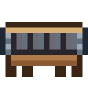 | 🛤 | [`railway_track.png`](railway_track.png) |
|  | 🛶 | [`canoe.png`](canoe.png) |
| 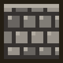 | 🟫‍⚫ | [`large_brown_square+medium_black_circle.png`](large_brown_square+medium_black_circle.png) |
|  | 🟫‍⬜ | [`large_brown_square+white_large_square.png`](large_brown_square+white_large_square.png) |
| 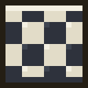 | 🟫‍🏁 | [`large_brown_square+chequered_flag.png`](large_brown_square+chequered_flag.png) |
|  | 🟫‍🔲 | [`large_brown_square+black_square_button.png`](large_brown_square+black_square_button.png) |
| 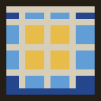 | 🟫‍🟦 | [`large_brown_square+large_blue_square.png`](large_brown_square+large_blue_square.png) |
|  | 🟫‍🟧 | [`large_brown_square+large_orange_square.png`](large_brown_square+large_orange_square.png) |
|  | 🟫‍🪚 | [`large_brown_square+carpentry_saw.png`](large_brown_square+carpentry_saw.png) |
|  | 🟫‍🪨 | [`large_brown_square+rock.png`](large_brown_square+rock.png) |
| 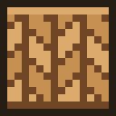 | 🟫‍🪵 | [`large_brown_square+wood.png`](large_brown_square+wood.png) |
|  | 🤒 | [`face_with_thermometer.png`](face_with_thermometer.png) |
|  | 🤖 | [`robot_face.png`](robot_face.png) |
| 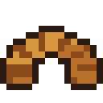 | 🥐 | [`croissant.png`](croissant.png) |
|  | 🥒 | [`cucumber.png`](cucumber.png) |
|  | 🥔 | [`potato.png`](potato.png) |
|  | 🥕 | [`carrot.png`](carrot.png) |
|  | 🥖 | [`baguette_bread.png`](baguette_bread.png) |
| 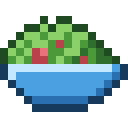 | 🥗 | [`green_salad.png`](green_salad.png) |
| 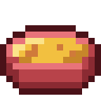 | 🥘 | [`shallow_pan_of_food.png`](shallow_pan_of_food.png) |
|  | 🥚 | [`egg.png`](egg.png) |
|  | 🥛 | [`glass_of_milk.png`](glass_of_milk.png) |
|  | 🥛‍🏔 | [`glass_of_milk+snow_capped_mountain.png`](glass_of_milk+snow_capped_mountain.png) |
|  | 🥣 | [`bowl_with_spoon.png`](bowl_with_spoon.png) |
|  | 🥧 | [`pie.png`](pie.png) |
|  | 🥧‍🥬 | [`pie+leafy_green.png`](pie+leafy_green.png) |
|  | 🥧‍🫐 | [`pie+blueberries.png`](pie+blueberries.png) |
|  | 🥩 | [`cut_of_meat.png`](cut_of_meat.png) |
|  | 🥫 | [`canned_food.png`](canned_food.png) |
|  | 🥬 | [`leafy_green.png`](leafy_green.png) |
|  | 🥼‍🌱 | [`lab_coat+seedling.png`](lab_coat+seedling.png) |
|  | 🦪 | [`oyster.png`](oyster.png) |
|  | 🧀 | [`cheese_wedge.png`](cheese_wedge.png) |
|  | 🧀‍🥛 | [`cheese_wedge+glass_of_milk.png`](cheese_wedge+glass_of_milk.png) |
|  | 🧄 | [`garlic.png`](garlic.png) |
|  | 🧅 | [`onion.png`](onion.png) |
|  | 🧈‍⚪ | [`butter+medium_white_circle.png`](butter+medium_white_circle.png) |
|  | 🧈‍🔩 | [`butter+nut_and_bolt.png`](butter+nut_and_bolt.png) |
|  | 🧈‍🟠 | [`butter+large_orange_circle.png`](butter+large_orange_circle.png) |
|  | 🧈‍🟡 | [`butter+large_yellow_circle.png`](butter+large_yellow_circle.png) |
|  | 🧊 | [`ice_cube.png`](ice_cube.png) |
|  | 🧤‍🟫 | [`gloves+large_brown_square.png`](gloves+large_brown_square.png) |
|  | 🧥‍❄ | [`coat+snowflake.png`](coat+snowflake.png) |
|  | 🧪 | [`test_tube.png`](test_tube.png) |
|  | 🧭 | [`compass.png`](compass.png) |
|  | 🧰 | [`toolbox.png`](toolbox.png) |
|  | 🧱 | [`brick.png`](brick.png) |
|  | 🧱‍⬜ | [`brick+white_large_square.png`](brick+white_large_square.png) |
|  | 🧱‍📐 | [`brick+triangular_ruler.png`](brick+triangular_ruler.png) |
|  | 🧱‍🟥 | [`brick+large_red_square.png`](brick+large_red_square.png) |
|  | 🧱‍🟦 | [`brick+large_blue_square.png`](brick+large_blue_square.png) |
|  | 🧱‍🟧 | [`brick+large_orange_square.png`](brick+large_orange_square.png) |
|  | 🧱‍🟨 | [`brick+large_yellow_square.png`](brick+large_yellow_square.png) |
|  | 🧱‍🟫 | [`brick+large_brown_square.png`](brick+large_brown_square.png) |
|  | 🧱‍🪟 | [`brick+window.png`](brick+window.png) |
|  | 🧱‍🪨 | [`brick+rock.png`](brick+rock.png) |
|  | 🧱‍🪵 | [`brick+wood.png`](brick+wood.png) |
|  | 🧵 | [`spool_of_thread.png`](spool_of_thread.png) |
|  | 🧶 | [`ball_of_yarn.png`](ball_of_yarn.png) |
|  | 🧺 | [`basket.png`](basket.png) |
|  | 🪑 | [`chair.png`](chair.png) |
|  | 🪓 | [`axe.png`](axe.png) |
|  | 🪚 | [`carpentry_saw.png`](carpentry_saw.png) |
|  | 🪜 | [`ladder.png`](ladder.png) |
|  | 🪟 | [`window.png`](window.png) |
|  | 🪟‍⭕ | [`window+heavy_large_circle.png`](window+heavy_large_circle.png) |
|  | 🪟‍🌈 | [`window+rainbow.png`](window+rainbow.png) |
|  | 🪟‍🌙 | [`window+crescent_moon.png`](window+crescent_moon.png) |
|  | 🪟‍🟩 | [`window+large_green_square.png`](window+large_green_square.png) |
|  | 🪡 | [`sewing_needle.png`](sewing_needle.png) |
|  | 🪢 | [`knot.png`](knot.png) |
|  | 🪣 | [`bucket.png`](bucket.png) |
|  | 🪨 | [`rock.png`](rock.png) |
|  | 🪨‍⚙ | [`rock+gear.png`](rock+gear.png) |
|  | 🪨‍⚪ | [`rock+medium_white_circle.png`](rock+medium_white_circle.png) |
|  | 🪨‍🐚 | [`rock+spiral_shell.png`](rock+spiral_shell.png) |
|  | 🪨‍🔩 | [`rock+nut_and_bolt.png`](rock+nut_and_bolt.png) |
|  | 🪨‍🟠 | [`rock+large_orange_circle.png`](rock+large_orange_circle.png) |
|  | 🪨‍🟡 | [`rock+large_yellow_circle.png`](rock+large_yellow_circle.png) |
|  | 🪨‍🪲 | [`rock+beetle.png`](rock+beetle.png) |
|  | 🪴 | [`potted_plant.png`](potted_plant.png) |
|  | 🪴‍🌷 | [`potted_plant+tulip.png`](potted_plant+tulip.png) |
|  | 🪵 | [`wood.png`](wood.png) |
|  | 🪵‍🌈 | [`wood+rainbow.png`](wood+rainbow.png) |
|  | 🪵‍🔗 | [`wood+link_symbol.png`](wood+link_symbol.png) |
|  | 🪸 | [`coral.png`](coral.png) |
|  | 🪹 | [`empty_nest.png`](empty_nest.png) |
|  | 🪺 | [`nest_with_eggs.png`](nest_with_eggs.png) |
|  | 🫐 | [`blueberries.png`](blueberries.png) |
|  | 🫐‍⚫ | [`blueberries+medium_black_circle.png`](blueberries+medium_black_circle.png) |
|  | 🫑 | [`bell_pepper.png`](bell_pepper.png) |
|  | 🫕 | [`fondue.png`](fondue.png) |
|  | 🫘 | [`beans.png`](beans.png) |
|  | 🫙 | [`jar.png`](jar.png) |
|  | 🫙‍🌰 | [`jar+chestnut.png`](jar+chestnut.png) |
|  | 🫙‍🍓 | [`jar+strawberry.png`](jar+strawberry.png) |
|  | 🫙‍🥚 | [`jar+egg.png`](jar+egg.png) |
