# Les icônes du jeu

> Dossier produit par `python3 scripts/icones/export.py` (lancé aussi par `scripts/icones/build.py`) :
> ne pas le modifier à la main, il est refait à chaque construction des planches.

| Dossier | Contenu |
|---|---|
| [`16px/`](16px) | les 422 icônes d'emoji à leur taille réelle (16×16, fond transparent) : **à retoucher** |
| [`x8/`](x8) | les mêmes agrandies 8 fois (128×128), pour les regarder |
| [`dessins/`](dessins) | les 35 dessins de 32×32 (bâtiments, arbres, bêtes, boutons), et agrandis 4 fois dans `dessins/agrandis/` |

## Télécharger

- Une icône : ouvrir le fichier sur GitHub, puis le bouton « Download raw file ».
- Tout le dossier : sur la page du dépôt, « Code » → « Download ZIP », puis garder `icones/`.

## Retoucher

Retoucher **le fichier de `16px/`** (pas l'agrandi) dans un logiciel de pixel art
(Aseprite, Piskel, LibreSprite…), sans anticrénelage ni flou. Le style : contour de 1 px
dans une teinte très sombre de la couleur de l'objet, lumière en haut à gauche, 3 à 4
teintes par matière, l'objet occupe 12 à 15 px.

Le jeu ne lit pas ce dossier : il dessine ses icônes depuis le fichier indiqué dans la
colonne « Source » ci-dessous. Pour qu'une retouche entre dans le jeu, la reporter dans ce
fichier puis lancer `python3 scripts/icones/build.py` (voir [`docs/icones.md`](../docs/icones.md)).

## Icônes d'emoji (422)

| Icône | Emoji | Fichier | Source |
|:---:|:---:|---|---|
|  | ℹ | [`information_source.png`](16px/information_source.png) | `scripts/icones/art_symboles.py` |
|  | ⏱ | [`stopwatch.png`](16px/stopwatch.png) | `scripts/icones/art_symboles.py` |
|  | ⏳ | [`hourglass_with_flowing_sand.png`](16px/hourglass_with_flowing_sand.png) | `scripts/icones/art_symboles.py` |
| 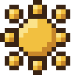 | ☀ | [`black_sun_with_rays.png`](16px/black_sun_with_rays.png) | `scripts/icones/art_nature.py` |
|  | ☕ | [`hot_beverage.png`](16px/hot_beverage.png) | `scripts/icones/art_cuisine.py` |
|  | ☕‍🍫 | [`hot_beverage+chocolate_bar.png`](16px/hot_beverage+chocolate_bar.png) | `scripts/icones/art_cuisine.py` |
|  | ☕‍🔥 | [`hot_beverage+fire.png`](16px/hot_beverage+fire.png) | `scripts/icones/art_cuisine.py` |
|  | ⚒ | [`hammer_and_pick.png`](16px/hammer_and_pick.png) | `scripts/icones/art_outils.py` |
|  | ⚙ | [`gear.png`](16px/gear.png) | `scripts/icones/art_outils.py` |
|  | ⚙‍🌾 | [`gear+ear_of_rice.png`](16px/gear+ear_of_rice.png) | `scripts/icones/art_atelier.py` |
|  | ⚠ | [`warning_sign.png`](16px/warning_sign.png) | `scripts/icones/art_symboles.py` |
|  | ⚡ | [`high_voltage_sign.png`](16px/high_voltage_sign.png) | `scripts/icones/art_essai.py` |
|  | ⛏ | [`pick.png`](16px/pick.png) | `scripts/icones/art_outils.py` |
|  | ⛑‍💡 | [`helmet_with_white_cross+electric_light_bulb.png`](16px/helmet_with_white_cross+electric_light_bulb.png) | `scripts/icones/art_equipement.py` |
|  | ⛔ | [`no_entry.png`](16px/no_entry.png) | `scripts/icones/art_symboles.py` |
|  | ⛲ | [`fountain.png`](16px/fountain.png) | `scripts/icones/art_lieux.py` |
|  | ✂ | [`black_scissors.png`](16px/black_scissors.png) | `scripts/icones/art_outils.py` |
|  | ✅ | [`white_heavy_check_mark.png`](16px/white_heavy_check_mark.png) | `scripts/icones/art_symboles.py` |
|  | ✉ | [`envelope.png`](16px/envelope.png) | `scripts/icones/art_outils.py` |
|  | ✏ | [`pencil.png`](16px/pencil.png) | `scripts/icones/art_symboles.py` |
|  | ✨ | [`sparkles.png`](16px/sparkles.png) | `scripts/icones/art_symboles.py` |
|  | ❄ | [`snowflake.png`](16px/snowflake.png) | `scripts/icones/art_nature.py` |
|  | ❌ | [`cross_mark.png`](16px/cross_mark.png) | `scripts/icones/art_symboles.py` |
|  | ❤ | [`heavy_black_heart.png`](16px/heavy_black_heart.png) | `scripts/icones/art_symboles.py` |
|  | ➕ | [`heavy_plus_sign.png`](16px/heavy_plus_sign.png) | `scripts/icones/art_symboles.py` |
|  | ➰ | [`curly_loop.png`](16px/curly_loop.png) | `scripts/icones/art_cheval.py` |
|  | ⬜ | [`white_large_square.png`](16px/white_large_square.png) | `scripts/icones/art_symboles.py` |
|  | ⭐‍🌊 | [`white_medium_star+water_wave.png`](16px/white_medium_star+water_wave.png) | `scripts/icones/art_nature.py` |
|  | 🌅 | [`sunrise.png`](16px/sunrise.png) | `scripts/icones/art_nature.py` |
|  | 🌑 | [`new_moon_symbol.png`](16px/new_moon_symbol.png) | `scripts/icones/art_nature.py` |
|  | 🌒 | [`waxing_crescent_moon_symbol.png`](16px/waxing_crescent_moon_symbol.png) | `scripts/icones/art_nature.py` |
|  | 🌕 | [`full_moon_symbol.png`](16px/full_moon_symbol.png) | `scripts/icones/art_nature.py` |
|  | 🌘 | [`waning_crescent_moon_symbol.png`](16px/waning_crescent_moon_symbol.png) | `scripts/icones/art_nature.py` |
|  | 🌙 | [`crescent_moon.png`](16px/crescent_moon.png) | `scripts/icones/art_nature.py` |
| 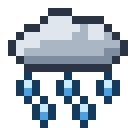 | 🌧 | [`cloud_with_rain.png`](16px/cloud_with_rain.png) | `scripts/icones/art_nature.py` |
|  | 🌰 | [`chestnut.png`](16px/chestnut.png) | `scripts/icones/art_nature.py` |
|  | 🌱 | [`seedling.png`](16px/seedling.png) | `scripts/icones/art_essai.py` |
|  | 🌱‍🌻 | [`seedling+sunflower.png`](16px/seedling+sunflower.png) | `dérivée (derived() d'un art_*.py)` |
|  | 🌱‍🍅 | [`seedling+tomato.png`](16px/seedling+tomato.png) | `dérivée (derived() d'un art_*.py)` |
|  | 🌱‍🍆 | [`seedling+aubergine.png`](16px/seedling+aubergine.png) | `dérivée (derived() d'un art_*.py)` |
|  | 🌱‍🍎 | [`seedling+red_apple.png`](16px/seedling+red_apple.png) | `scripts/icones/art_atelier.py` |
|  | 🌱‍🍐 | [`seedling+pear.png`](16px/seedling+pear.png) | `scripts/icones/art_atelier.py` |
|  | 🌱‍🍑 | [`seedling+peach.png`](16px/seedling+peach.png) | `scripts/icones/art_atelier.py` |
|  | 🌱‍🍒 | [`seedling+cherries.png`](16px/seedling+cherries.png) | `scripts/icones/art_atelier.py` |
|  | 🌱‍🍓 | [`seedling+strawberry.png`](16px/seedling+strawberry.png) | `dérivée (derived() d'un art_*.py)` |
|  | 🌱‍🟠 | [`seedling+large_orange_circle.png`](16px/seedling+large_orange_circle.png) | `scripts/icones/art_atelier.py` |
| 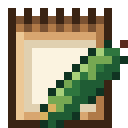 | 🌱‍🥒 | [`seedling+cucumber.png`](16px/seedling+cucumber.png) | `dérivée (derived() d'un art_*.py)` |
| 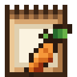 | 🌱‍🥕 | [`seedling+carrot.png`](16px/seedling+carrot.png) | `dérivée (derived() d'un art_*.py)` |
|  | 🌱‍🥬 | [`seedling+leafy_green.png`](16px/seedling+leafy_green.png) | `dérivée (derived() d'un art_*.py)` |
|  | 🌱‍🧅 | [`seedling+onion.png`](16px/seedling+onion.png) | `dérivée (derived() d'un art_*.py)` |
|  | 🌱‍🫑 | [`seedling+bell_pepper.png`](16px/seedling+bell_pepper.png) | `dérivée (derived() d'un art_*.py)` |
| 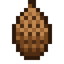 | 🌲‍🟤 | [`evergreen_tree+large_brown_circle.png`](16px/evergreen_tree+large_brown_circle.png) | `scripts/icones/art_graines_arbres.py` |
|  | 🌳 | [`deciduous_tree.png`](16px/deciduous_tree.png) | `scripts/icones/art_nature.py` |
|  | 🌳‍🟤 | [`deciduous_tree+large_brown_circle.png`](16px/deciduous_tree+large_brown_circle.png) | `scripts/icones/art_graines_arbres.py` |
|  | 🌶 | [`hot_pepper.png`](16px/hot_pepper.png) | `scripts/icones/art_ville.py` |
|  | 🌻 | [`sunflower.png`](16px/sunflower.png) | `scripts/icones/art_nature.py` |
|  | 🌾 | [`ear_of_rice.png`](16px/ear_of_rice.png) | `scripts/icones/art_recoltes.py` |
| 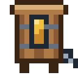 | 🌾‍⚙ | [`ear_of_rice+gear.png`](16px/ear_of_rice+gear.png) | `scripts/icones/art_atelier.py` |
|  | 🌾‍🔪 | [`ear_of_rice+hocho.png`](16px/ear_of_rice+hocho.png) | `scripts/icones/art_outils.py` |
|  | 🌾‍🛶 | [`ear_of_rice+canoe.png`](16px/ear_of_rice+canoe.png) | `scripts/icones/art_atelier.py` |
|  | 🌾‍🪜 | [`ear_of_rice+ladder.png`](16px/ear_of_rice+ladder.png) | `scripts/icones/art_cheval.py` |
|  | 🌿 | [`herb.png`](16px/herb.png) | `scripts/icones/art_nature.py` |
|  | 🌿‍🌊 | [`herb+water_wave.png`](16px/herb+water_wave.png) | `scripts/icones/art_nature.py` |
|  | 🌿‍🏔 | [`herb+snow_capped_mountain.png`](16px/herb+snow_capped_mountain.png) | `assets/trouvailles.png (case 8, 0)` |
| 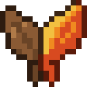 | 🍂 | [`fallen_leaf.png`](16px/fallen_leaf.png) | `scripts/icones/art_nature.py` |
|  | 🍄 | [`mushroom.png`](16px/mushroom.png) | `scripts/icones/art_ville.py` |
|  | 🍄‍✨ | [`mushroom+sparkles.png`](16px/mushroom+sparkles.png) | `scripts/icones/art_atelier.py` |
|  | 🍅 | [`tomato.png`](16px/tomato.png) | `scripts/icones/art_recoltes.py` |
|  | 🍆 | [`aubergine.png`](16px/aubergine.png) | `scripts/icones/art_nature.py` |
|  | 🍎 | [`red_apple.png`](16px/red_apple.png) | `scripts/icones/art_recoltes.py` |
|  | 🍐 | [`pear.png`](16px/pear.png) | `scripts/icones/art_nature.py` |
| 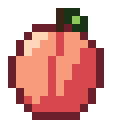 | 🍑 | [`peach.png`](16px/peach.png) | `scripts/icones/art_atelier.py` |
| 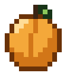 | 🍑‍🟠 | [`peach+large_orange_circle.png`](16px/peach+large_orange_circle.png) | `scripts/icones/art_atelier.py` |
| 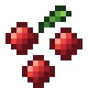 | 🍒 | [`cherries.png`](16px/cherries.png) | `scripts/icones/art_atelier.py` |
|  | 🍒‍🌸 | [`cherries+cherry_blossom.png`](16px/cherries+cherry_blossom.png) | `scripts/icones/art_atelier.py` |
|  | 🍓 | [`strawberry.png`](16px/strawberry.png) | `scripts/icones/art_recoltes.py` |
|  | 🍔 | [`hamburger.png`](16px/hamburger.png) | `scripts/icones/art_boutiques.py` |
|  | 🍕 | [`slice_of_pizza.png`](16px/slice_of_pizza.png) | `scripts/icones/art_boutiques.py` |
| 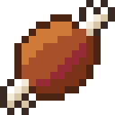 | 🍖 | [`meat_on_bone.png`](16px/meat_on_bone.png) | `scripts/icones/art_cuisine.py` |
|  | 🍗 | [`poultry_leg.png`](16px/poultry_leg.png) | `scripts/icones/art_cuisine.py` |
|  | 🍚 | [`cooked_rice.png`](16px/cooked_rice.png) | `scripts/icones/art_cuisine.py` |
|  | 🍚‍🥛 | [`cooked_rice+glass_of_milk.png`](16px/cooked_rice+glass_of_milk.png) | `scripts/icones/art_cuisine.py` |
| 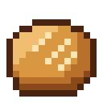 | 🍞 | [`bread.png`](16px/bread.png) | `scripts/icones/art_cuisine.py` |
|  | 🍞‍🍯 | [`bread+honey_pot.png`](16px/bread+honey_pot.png) | `scripts/icones/art_cuisine.py` |
|  | 🍟 | [`french_fries.png`](16px/french_fries.png) | `scripts/icones/art_boutiques.py` |
|  | 🍨 | [`ice_cream.png`](16px/ice_cream.png) | `scripts/icones/art_cuisine.py` |
|  | 🍫 | [`chocolate_bar.png`](16px/chocolate_bar.png) | `scripts/icones/art_cuisine.py` |
|  | 🍬 | [`candy.png`](16px/candy.png) | `scripts/icones/art_ville.py` |
|  | 🍮 | [`custard.png`](16px/custard.png) | `scripts/icones/art_cuisine.py` |
|  | 🍯 | [`honey_pot.png`](16px/honey_pot.png) | `scripts/icones/art_ville.py` |
|  | 🍰 | [`shortcake.png`](16px/shortcake.png) | `scripts/icones/art_cuisine.py` |
|  | 🍲 | [`pot_of_food.png`](16px/pot_of_food.png) | `scripts/icones/art_cuisine.py` |
|  | 🍲‍🥕 | [`pot_of_food+carrot.png`](16px/pot_of_food+carrot.png) | `scripts/icones/art_cuisine.py` |
|  | 🍳 | [`cooking.png`](16px/cooking.png) | `scripts/icones/art_cuisine.py` |
|  | 🍳‍🍄 | [`cooking+mushroom.png`](16px/cooking+mushroom.png) | `scripts/icones/art_cuisine.py` |
| 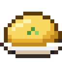 | 🍳‍🥚 | [`cooking+egg.png`](16px/cooking+egg.png) | `scripts/icones/art_cuisine.py` |
|  | 🍺 | [`beer_mug.png`](16px/beer_mug.png) | `scripts/icones/art_cuisine.py` |
|  | 🍽 | [`fork_and_knife_with_plate.png`](16px/fork_and_knife_with_plate.png) | `scripts/icones/art_cuisine.py` |
| 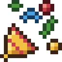 | 🎉 | [`party_popper.png`](16px/party_popper.png) | `scripts/icones/art_symboles.py` |
|  | 🎍 | [`pine_decoration.png`](16px/pine_decoration.png) | `scripts/icones/art_atelier.py` |
| 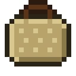 | 🎒‍🌿 | [`school_satchel+herb.png`](16px/school_satchel+herb.png) | `scripts/icones/art_equipement.py` |
|  | 🎒‍🧶 | [`school_satchel+ball_of_yarn.png`](16px/school_satchel+ball_of_yarn.png) | `scripts/icones/art_equipement.py` |
|  | 🎛 | [`control_knobs.png`](16px/control_knobs.png) | `scripts/icones/art_outils.py` |
|  | 🎣 | [`fishing_pole_and_fish.png`](16px/fishing_pole_and_fish.png) | `scripts/icones/art_outils.py` |
|  | 🎬 | [`clapper_board.png`](16px/clapper_board.png) | `scripts/icones/art_ville.py` |
|  | 🎭 | [`performing_arts.png`](16px/performing_arts.png) | `scripts/icones/art_ville.py` |
| 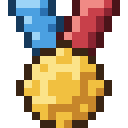 | 🏅 | [`sports_medal.png`](16px/sports_medal.png) | `scripts/icones/art_symboles.py` |
|  | 🏆 | [`trophy.png`](16px/trophy.png) | `scripts/icones/art_symboles.py` |
|  | 🏗 | [`building_construction.png`](16px/building_construction.png) | `scripts/icones/art_lieux.py` |
|  | 🏘 | [`house_buildings.png`](16px/house_buildings.png) | `scripts/icones/art_monde.py` |
|  | 🏙 | [`cityscape.png`](16px/cityscape.png) | `scripts/icones/art_ville.py` |
|  | 🏚 | [`derelict_house_building.png`](16px/derelict_house_building.png) | `scripts/icones/art_lieux.py` |
|  | 🏠 | [`house_building.png`](16px/house_building.png) | `scripts/icones/art_lieux.py` |
|  | 🏡 | [`house_with_garden.png`](16px/house_with_garden.png) | `scripts/icones/art_lieux.py` |
|  | 🏪 | [`convenience_store.png`](16px/convenience_store.png) | `scripts/icones/art_lieux.py` |
|  | 🏮 | [`izakaya_lantern.png`](16px/izakaya_lantern.png) | `scripts/icones/art_atelier.py` |
| 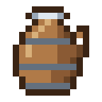 | 🏺 | [`amphora.png`](16px/amphora.png) | `scripts/icones/art_atelier.py` |
|  | 🐄 | [`cow.png`](16px/cow.png) | `scripts/icones/art_lieux.py` |
| 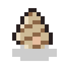 | 🐌 | [`snail.png`](16px/snail.png) | `assets/trouvailles.png (case 5, 0)` |
| 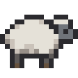 | 🐑 | [`sheep.png`](16px/sheep.png) | `scripts/icones/art_essai.py` |
| 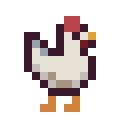 | 🐔 | [`chicken.png`](16px/chicken.png) | `scripts/icones/art_essai.py` |
|  | 🐚 | [`spiral_shell.png`](16px/spiral_shell.png) | `assets/trouvailles.png (case 4, 0)` |
|  | 🐝 | [`honeybee.png`](16px/honeybee.png) | `scripts/icones/art_ruche.py` |
|  | 🐟 | [`fish.png`](16px/fish.png) | `scripts/icones/art_ville.py` |
|  | 🐟‍❄ | [`fish+snowflake.png`](16px/fish+snowflake.png) | `scripts/icones/art_ville.py` |
|  | 🐟‍⭐ | [`fish+white_medium_star.png`](16px/fish+white_medium_star.png) | `scripts/icones/art_ville.py` |
| 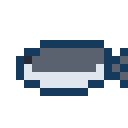 | 🐟‍🌀 | [`fish+cyclone.png`](16px/fish+cyclone.png) | `scripts/icones/art_ville.py` |
|  | 🐟‍🌈 | [`fish+rainbow.png`](16px/fish+rainbow.png) | `scripts/icones/art_ville.py` |
|  | 🐟‍🌊 | [`fish+water_wave.png`](16px/fish+water_wave.png) | `scripts/icones/art_ville.py` |
|  | 🐟‍💧 | [`fish+droplet.png`](16px/fish+droplet.png) | `scripts/icones/art_ville.py` |
| 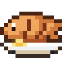 | 🐟‍🔥 | [`fish+fire.png`](16px/fish+fire.png) | `scripts/icones/art_cuisine.py` |
| 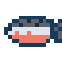 | 🐟‍🔶 | [`fish+large_orange_diamond.png`](16px/fish+large_orange_diamond.png) | `scripts/icones/art_ville.py` |
| 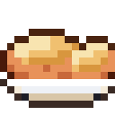 | 🐟‍🥟 | [`fish+dumpling.png`](16px/fish+dumpling.png) | `scripts/icones/art_cuisine.py` |
| 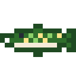 | 🐟‍🦷 | [`fish+tooth.png`](16px/fish+tooth.png) | `scripts/icones/art_ville.py` |
|  | 🐟‍🪨 | [`fish+rock.png`](16px/fish+rock.png) | `scripts/icones/art_ville.py` |
|  | 🐱 | [`cat_face.png`](16px/cat_face.png) | `scripts/icones/art_lieux.py` |
|  | 🐴 | [`horse_face.png`](16px/horse_face.png) | `scripts/icones/art_cheval.py` |
|  | 🐶 | [`dog_face.png`](16px/dog_face.png) | `scripts/icones/art_lieux.py` |
| 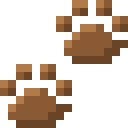 | 🐾 | [`paw_prints.png`](16px/paw_prints.png) | `scripts/icones/art_lieux.py` |
|  | 👋 | [`waving_hand_sign.png`](16px/waving_hand_sign.png) | `scripts/icones/art_gens.py` |
|  | 👒‍🌾 | [`womans_hat+ear_of_rice.png`](16px/womans_hat+ear_of_rice.png) | `scripts/icones/art_equipement.py` |
| 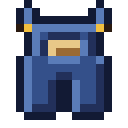 | 👖‍🔧 | [`jeans+wrench.png`](16px/jeans+wrench.png) | `scripts/icones/art_equipement.py` |
|  | 👢‍🟫 | [`womans_boots+large_brown_square.png`](16px/womans_boots+large_brown_square.png) | `scripts/icones/art_equipement.py` |
|  | 👦 | [`boy.png`](16px/boy.png) | `scripts/icones/art_gens.py` |
|  | 👦‍👱 | [`boy+person_with_blond_hair.png`](16px/boy+person_with_blond_hair.png) | `scripts/icones/art_gens.py` |
|  | 👦‍🦰 | [`boy+emoji_component_red_hair.png`](16px/boy+emoji_component_red_hair.png) | `scripts/icones/art_gens.py` |
|  | 👦‍🦱 | [`boy+emoji_component_curly_hair.png`](16px/boy+emoji_component_curly_hair.png) | `scripts/icones/art_gens.py` |
|  | 👦‍🧢 | [`boy+billed_cap.png`](16px/boy+billed_cap.png) | `scripts/icones/art_gens.py` |
|  | 👦🏻 | [`boy_skin_type_1_2.png`](16px/boy_skin_type_1_2.png) | `scripts/icones/art_gens.py` |
|  | 👦🏻‍👱 | [`boy_skin_type_1_2+person_with_blond_hair.png`](16px/boy_skin_type_1_2+person_with_blond_hair.png) | `scripts/icones/art_gens.py` |
| 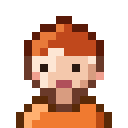 | 👦🏻‍🦰 | [`boy_skin_type_1_2+emoji_component_red_hair.png`](16px/boy_skin_type_1_2+emoji_component_red_hair.png) | `scripts/icones/art_gens.py` |
|  | 👦🏻‍🦱 | [`boy_skin_type_1_2+emoji_component_curly_hair.png`](16px/boy_skin_type_1_2+emoji_component_curly_hair.png) | `scripts/icones/art_gens.py` |
|  | 👦🏻‍🧢 | [`boy_skin_type_1_2+billed_cap.png`](16px/boy_skin_type_1_2+billed_cap.png) | `scripts/icones/art_gens.py` |
|  | 👦🏼 | [`boy_skin_type_3.png`](16px/boy_skin_type_3.png) | `scripts/icones/art_gens.py` |
|  | 👦🏼‍👱 | [`boy_skin_type_3+person_with_blond_hair.png`](16px/boy_skin_type_3+person_with_blond_hair.png) | `scripts/icones/art_gens.py` |
|  | 👦🏼‍🦰 | [`boy_skin_type_3+emoji_component_red_hair.png`](16px/boy_skin_type_3+emoji_component_red_hair.png) | `scripts/icones/art_gens.py` |
|  | 👦🏼‍🦱 | [`boy_skin_type_3+emoji_component_curly_hair.png`](16px/boy_skin_type_3+emoji_component_curly_hair.png) | `scripts/icones/art_gens.py` |
|  | 👦🏼‍🧢 | [`boy_skin_type_3+billed_cap.png`](16px/boy_skin_type_3+billed_cap.png) | `scripts/icones/art_gens.py` |
|  | 👦🏽 | [`boy_skin_type_4.png`](16px/boy_skin_type_4.png) | `scripts/icones/art_gens.py` |
|  | 👦🏽‍👱 | [`boy_skin_type_4+person_with_blond_hair.png`](16px/boy_skin_type_4+person_with_blond_hair.png) | `scripts/icones/art_gens.py` |
|  | 👦🏽‍🦰 | [`boy_skin_type_4+emoji_component_red_hair.png`](16px/boy_skin_type_4+emoji_component_red_hair.png) | `scripts/icones/art_gens.py` |
|  | 👦🏽‍🦱 | [`boy_skin_type_4+emoji_component_curly_hair.png`](16px/boy_skin_type_4+emoji_component_curly_hair.png) | `scripts/icones/art_gens.py` |
|  | 👦🏽‍🧢 | [`boy_skin_type_4+billed_cap.png`](16px/boy_skin_type_4+billed_cap.png) | `scripts/icones/art_gens.py` |
|  | 👦🏾 | [`boy_skin_type_5.png`](16px/boy_skin_type_5.png) | `scripts/icones/art_gens.py` |
|  | 👦🏾‍👱 | [`boy_skin_type_5+person_with_blond_hair.png`](16px/boy_skin_type_5+person_with_blond_hair.png) | `scripts/icones/art_gens.py` |
|  | 👦🏾‍🦰 | [`boy_skin_type_5+emoji_component_red_hair.png`](16px/boy_skin_type_5+emoji_component_red_hair.png) | `scripts/icones/art_gens.py` |
|  | 👦🏾‍🦱 | [`boy_skin_type_5+emoji_component_curly_hair.png`](16px/boy_skin_type_5+emoji_component_curly_hair.png) | `scripts/icones/art_gens.py` |
|  | 👦🏾‍🧢 | [`boy_skin_type_5+billed_cap.png`](16px/boy_skin_type_5+billed_cap.png) | `scripts/icones/art_gens.py` |
|  | 👦🏿 | [`boy_skin_type_6.png`](16px/boy_skin_type_6.png) | `scripts/icones/art_gens.py` |
|  | 👦🏿‍👱 | [`boy_skin_type_6+person_with_blond_hair.png`](16px/boy_skin_type_6+person_with_blond_hair.png) | `scripts/icones/art_gens.py` |
|  | 👦🏿‍🦰 | [`boy_skin_type_6+emoji_component_red_hair.png`](16px/boy_skin_type_6+emoji_component_red_hair.png) | `scripts/icones/art_gens.py` |
|  | 👦🏿‍🦱 | [`boy_skin_type_6+emoji_component_curly_hair.png`](16px/boy_skin_type_6+emoji_component_curly_hair.png) | `scripts/icones/art_gens.py` |
|  | 👦🏿‍🧢 | [`boy_skin_type_6+billed_cap.png`](16px/boy_skin_type_6+billed_cap.png) | `scripts/icones/art_gens.py` |
|  | 👧 | [`girl.png`](16px/girl.png) | `scripts/icones/art_gens.py` |
|  | 👧‍👱 | [`girl+person_with_blond_hair.png`](16px/girl+person_with_blond_hair.png) | `scripts/icones/art_gens.py` |
|  | 👧‍🦰 | [`girl+emoji_component_red_hair.png`](16px/girl+emoji_component_red_hair.png) | `scripts/icones/art_gens.py` |
|  | 👧‍🦱 | [`girl+emoji_component_curly_hair.png`](16px/girl+emoji_component_curly_hair.png) | `scripts/icones/art_gens.py` |
|  | 👧‍🧢 | [`girl+billed_cap.png`](16px/girl+billed_cap.png) | `scripts/icones/art_gens.py` |
|  | 👧🏻 | [`girl_skin_type_1_2.png`](16px/girl_skin_type_1_2.png) | `scripts/icones/art_gens.py` |
|  | 👧🏻‍👱 | [`girl_skin_type_1_2+person_with_blond_hair.png`](16px/girl_skin_type_1_2+person_with_blond_hair.png) | `scripts/icones/art_gens.py` |
|  | 👧🏻‍🦰 | [`girl_skin_type_1_2+emoji_component_red_hair.png`](16px/girl_skin_type_1_2+emoji_component_red_hair.png) | `scripts/icones/art_gens.py` |
|  | 👧🏻‍🦱 | [`girl_skin_type_1_2+emoji_component_curly_hair.png`](16px/girl_skin_type_1_2+emoji_component_curly_hair.png) | `scripts/icones/art_gens.py` |
|  | 👧🏻‍🧢 | [`girl_skin_type_1_2+billed_cap.png`](16px/girl_skin_type_1_2+billed_cap.png) | `scripts/icones/art_gens.py` |
|  | 👧🏼 | [`girl_skin_type_3.png`](16px/girl_skin_type_3.png) | `scripts/icones/art_gens.py` |
|  | 👧🏼‍👱 | [`girl_skin_type_3+person_with_blond_hair.png`](16px/girl_skin_type_3+person_with_blond_hair.png) | `scripts/icones/art_gens.py` |
|  | 👧🏼‍🦰 | [`girl_skin_type_3+emoji_component_red_hair.png`](16px/girl_skin_type_3+emoji_component_red_hair.png) | `scripts/icones/art_gens.py` |
|  | 👧🏼‍🦱 | [`girl_skin_type_3+emoji_component_curly_hair.png`](16px/girl_skin_type_3+emoji_component_curly_hair.png) | `scripts/icones/art_gens.py` |
|  | 👧🏼‍🧢 | [`girl_skin_type_3+billed_cap.png`](16px/girl_skin_type_3+billed_cap.png) | `scripts/icones/art_gens.py` |
|  | 👧🏽 | [`girl_skin_type_4.png`](16px/girl_skin_type_4.png) | `scripts/icones/art_gens.py` |
|  | 👧🏽‍👱 | [`girl_skin_type_4+person_with_blond_hair.png`](16px/girl_skin_type_4+person_with_blond_hair.png) | `scripts/icones/art_gens.py` |
|  | 👧🏽‍🦰 | [`girl_skin_type_4+emoji_component_red_hair.png`](16px/girl_skin_type_4+emoji_component_red_hair.png) | `scripts/icones/art_gens.py` |
|  | 👧🏽‍🦱 | [`girl_skin_type_4+emoji_component_curly_hair.png`](16px/girl_skin_type_4+emoji_component_curly_hair.png) | `scripts/icones/art_gens.py` |
|  | 👧🏽‍🧢 | [`girl_skin_type_4+billed_cap.png`](16px/girl_skin_type_4+billed_cap.png) | `scripts/icones/art_gens.py` |
|  | 👧🏾 | [`girl_skin_type_5.png`](16px/girl_skin_type_5.png) | `scripts/icones/art_gens.py` |
|  | 👧🏾‍👱 | [`girl_skin_type_5+person_with_blond_hair.png`](16px/girl_skin_type_5+person_with_blond_hair.png) | `scripts/icones/art_gens.py` |
|  | 👧🏾‍🦰 | [`girl_skin_type_5+emoji_component_red_hair.png`](16px/girl_skin_type_5+emoji_component_red_hair.png) | `scripts/icones/art_gens.py` |
|  | 👧🏾‍🦱 | [`girl_skin_type_5+emoji_component_curly_hair.png`](16px/girl_skin_type_5+emoji_component_curly_hair.png) | `scripts/icones/art_gens.py` |
|  | 👧🏾‍🧢 | [`girl_skin_type_5+billed_cap.png`](16px/girl_skin_type_5+billed_cap.png) | `scripts/icones/art_gens.py` |
|  | 👧🏿 | [`girl_skin_type_6.png`](16px/girl_skin_type_6.png) | `scripts/icones/art_gens.py` |
|  | 👧🏿‍👱 | [`girl_skin_type_6+person_with_blond_hair.png`](16px/girl_skin_type_6+person_with_blond_hair.png) | `scripts/icones/art_gens.py` |
|  | 👧🏿‍🦰 | [`girl_skin_type_6+emoji_component_red_hair.png`](16px/girl_skin_type_6+emoji_component_red_hair.png) | `scripts/icones/art_gens.py` |
|  | 👧🏿‍🦱 | [`girl_skin_type_6+emoji_component_curly_hair.png`](16px/girl_skin_type_6+emoji_component_curly_hair.png) | `scripts/icones/art_gens.py` |
|  | 👧🏿‍🧢 | [`girl_skin_type_6+billed_cap.png`](16px/girl_skin_type_6+billed_cap.png) | `scripts/icones/art_gens.py` |
|  | 👨 | [`man.png`](16px/man.png) | `scripts/icones/art_gens.py` |
|  | 👨‍👩‍👧‍👦 | [`man+woman+girl+boy.png`](16px/man+woman+girl+boy.png) | `scripts/icones/art_gens.py` |
|  | 👨‍👱 | [`man+person_with_blond_hair.png`](16px/man+person_with_blond_hair.png) | `scripts/icones/art_gens.py` |
|  | 👨‍🦰 | [`man+emoji_component_red_hair.png`](16px/man+emoji_component_red_hair.png) | `scripts/icones/art_gens.py` |
|  | 👨‍🦱 | [`man+emoji_component_curly_hair.png`](16px/man+emoji_component_curly_hair.png) | `scripts/icones/art_gens.py` |
|  | 👨‍🦳 | [`man+emoji_component_white_hair.png`](16px/man+emoji_component_white_hair.png) | `scripts/icones/art_gens.py` |
|  | 👨🏻 | [`man_skin_type_1_2.png`](16px/man_skin_type_1_2.png) | `scripts/icones/art_gens.py` |
|  | 👨🏻‍👱 | [`man_skin_type_1_2+person_with_blond_hair.png`](16px/man_skin_type_1_2+person_with_blond_hair.png) | `scripts/icones/art_gens.py` |
|  | 👨🏻‍🦰 | [`man_skin_type_1_2+emoji_component_red_hair.png`](16px/man_skin_type_1_2+emoji_component_red_hair.png) | `scripts/icones/art_gens.py` |
|  | 👨🏻‍🦱 | [`man_skin_type_1_2+emoji_component_curly_hair.png`](16px/man_skin_type_1_2+emoji_component_curly_hair.png) | `scripts/icones/art_gens.py` |
|  | 👨🏻‍🦳 | [`man_skin_type_1_2+emoji_component_white_hair.png`](16px/man_skin_type_1_2+emoji_component_white_hair.png) | `scripts/icones/art_gens.py` |
|  | 👨🏼 | [`man_skin_type_3.png`](16px/man_skin_type_3.png) | `scripts/icones/art_gens.py` |
|  | 👨🏼‍👱 | [`man_skin_type_3+person_with_blond_hair.png`](16px/man_skin_type_3+person_with_blond_hair.png) | `scripts/icones/art_gens.py` |
|  | 👨🏼‍🦰 | [`man_skin_type_3+emoji_component_red_hair.png`](16px/man_skin_type_3+emoji_component_red_hair.png) | `scripts/icones/art_gens.py` |
|  | 👨🏼‍🦱 | [`man_skin_type_3+emoji_component_curly_hair.png`](16px/man_skin_type_3+emoji_component_curly_hair.png) | `scripts/icones/art_gens.py` |
|  | 👨🏼‍🦳 | [`man_skin_type_3+emoji_component_white_hair.png`](16px/man_skin_type_3+emoji_component_white_hair.png) | `scripts/icones/art_gens.py` |
|  | 👨🏽 | [`man_skin_type_4.png`](16px/man_skin_type_4.png) | `scripts/icones/art_gens.py` |
|  | 👨🏽‍👱 | [`man_skin_type_4+person_with_blond_hair.png`](16px/man_skin_type_4+person_with_blond_hair.png) | `scripts/icones/art_gens.py` |
|  | 👨🏽‍🦰 | [`man_skin_type_4+emoji_component_red_hair.png`](16px/man_skin_type_4+emoji_component_red_hair.png) | `scripts/icones/art_gens.py` |
|  | 👨🏽‍🦱 | [`man_skin_type_4+emoji_component_curly_hair.png`](16px/man_skin_type_4+emoji_component_curly_hair.png) | `scripts/icones/art_gens.py` |
|  | 👨🏽‍🦳 | [`man_skin_type_4+emoji_component_white_hair.png`](16px/man_skin_type_4+emoji_component_white_hair.png) | `scripts/icones/art_gens.py` |
|  | 👨🏾 | [`man_skin_type_5.png`](16px/man_skin_type_5.png) | `scripts/icones/art_gens.py` |
|  | 👨🏾‍👱 | [`man_skin_type_5+person_with_blond_hair.png`](16px/man_skin_type_5+person_with_blond_hair.png) | `scripts/icones/art_gens.py` |
|  | 👨🏾‍🦰 | [`man_skin_type_5+emoji_component_red_hair.png`](16px/man_skin_type_5+emoji_component_red_hair.png) | `scripts/icones/art_gens.py` |
|  | 👨🏾‍🦱 | [`man_skin_type_5+emoji_component_curly_hair.png`](16px/man_skin_type_5+emoji_component_curly_hair.png) | `scripts/icones/art_gens.py` |
|  | 👨🏾‍🦳 | [`man_skin_type_5+emoji_component_white_hair.png`](16px/man_skin_type_5+emoji_component_white_hair.png) | `scripts/icones/art_gens.py` |
|  | 👨🏿 | [`man_skin_type_6.png`](16px/man_skin_type_6.png) | `scripts/icones/art_gens.py` |
|  | 👨🏿‍👱 | [`man_skin_type_6+person_with_blond_hair.png`](16px/man_skin_type_6+person_with_blond_hair.png) | `scripts/icones/art_gens.py` |
|  | 👨🏿‍🦰 | [`man_skin_type_6+emoji_component_red_hair.png`](16px/man_skin_type_6+emoji_component_red_hair.png) | `scripts/icones/art_gens.py` |
|  | 👨🏿‍🦱 | [`man_skin_type_6+emoji_component_curly_hair.png`](16px/man_skin_type_6+emoji_component_curly_hair.png) | `scripts/icones/art_gens.py` |
|  | 👨🏿‍🦳 | [`man_skin_type_6+emoji_component_white_hair.png`](16px/man_skin_type_6+emoji_component_white_hair.png) | `scripts/icones/art_gens.py` |
|  | 👩 | [`woman.png`](16px/woman.png) | `scripts/icones/art_gens.py` |
|  | 👩‍👱 | [`woman+person_with_blond_hair.png`](16px/woman+person_with_blond_hair.png) | `scripts/icones/art_gens.py` |
|  | 👩‍🦰 | [`woman+emoji_component_red_hair.png`](16px/woman+emoji_component_red_hair.png) | `scripts/icones/art_gens.py` |
|  | 👩‍🦱 | [`woman+emoji_component_curly_hair.png`](16px/woman+emoji_component_curly_hair.png) | `scripts/icones/art_gens.py` |
|  | 👩‍🦳 | [`woman+emoji_component_white_hair.png`](16px/woman+emoji_component_white_hair.png) | `scripts/icones/art_gens.py` |
|  | 👩🏻 | [`woman_skin_type_1_2.png`](16px/woman_skin_type_1_2.png) | `scripts/icones/art_gens.py` |
|  | 👩🏻‍👱 | [`woman_skin_type_1_2+person_with_blond_hair.png`](16px/woman_skin_type_1_2+person_with_blond_hair.png) | `scripts/icones/art_gens.py` |
|  | 👩🏻‍🦰 | [`woman_skin_type_1_2+emoji_component_red_hair.png`](16px/woman_skin_type_1_2+emoji_component_red_hair.png) | `scripts/icones/art_gens.py` |
|  | 👩🏻‍🦱 | [`woman_skin_type_1_2+emoji_component_curly_hair.png`](16px/woman_skin_type_1_2+emoji_component_curly_hair.png) | `scripts/icones/art_gens.py` |
|  | 👩🏻‍🦳 | [`woman_skin_type_1_2+emoji_component_white_hair.png`](16px/woman_skin_type_1_2+emoji_component_white_hair.png) | `scripts/icones/art_gens.py` |
|  | 👩🏼 | [`woman_skin_type_3.png`](16px/woman_skin_type_3.png) | `scripts/icones/art_gens.py` |
|  | 👩🏼‍👱 | [`woman_skin_type_3+person_with_blond_hair.png`](16px/woman_skin_type_3+person_with_blond_hair.png) | `scripts/icones/art_gens.py` |
|  | 👩🏼‍🦰 | [`woman_skin_type_3+emoji_component_red_hair.png`](16px/woman_skin_type_3+emoji_component_red_hair.png) | `scripts/icones/art_gens.py` |
|  | 👩🏼‍🦱 | [`woman_skin_type_3+emoji_component_curly_hair.png`](16px/woman_skin_type_3+emoji_component_curly_hair.png) | `scripts/icones/art_gens.py` |
|  | 👩🏼‍🦳 | [`woman_skin_type_3+emoji_component_white_hair.png`](16px/woman_skin_type_3+emoji_component_white_hair.png) | `scripts/icones/art_gens.py` |
|  | 👩🏽 | [`woman_skin_type_4.png`](16px/woman_skin_type_4.png) | `scripts/icones/art_gens.py` |
|  | 👩🏽‍👱 | [`woman_skin_type_4+person_with_blond_hair.png`](16px/woman_skin_type_4+person_with_blond_hair.png) | `scripts/icones/art_gens.py` |
|  | 👩🏽‍🦰 | [`woman_skin_type_4+emoji_component_red_hair.png`](16px/woman_skin_type_4+emoji_component_red_hair.png) | `scripts/icones/art_gens.py` |
|  | 👩🏽‍🦱 | [`woman_skin_type_4+emoji_component_curly_hair.png`](16px/woman_skin_type_4+emoji_component_curly_hair.png) | `scripts/icones/art_gens.py` |
|  | 👩🏽‍🦳 | [`woman_skin_type_4+emoji_component_white_hair.png`](16px/woman_skin_type_4+emoji_component_white_hair.png) | `scripts/icones/art_gens.py` |
|  | 👩🏾 | [`woman_skin_type_5.png`](16px/woman_skin_type_5.png) | `scripts/icones/art_gens.py` |
|  | 👩🏾‍👱 | [`woman_skin_type_5+person_with_blond_hair.png`](16px/woman_skin_type_5+person_with_blond_hair.png) | `scripts/icones/art_gens.py` |
|  | 👩🏾‍🦰 | [`woman_skin_type_5+emoji_component_red_hair.png`](16px/woman_skin_type_5+emoji_component_red_hair.png) | `scripts/icones/art_gens.py` |
|  | 👩🏾‍🦱 | [`woman_skin_type_5+emoji_component_curly_hair.png`](16px/woman_skin_type_5+emoji_component_curly_hair.png) | `scripts/icones/art_gens.py` |
|  | 👩🏾‍🦳 | [`woman_skin_type_5+emoji_component_white_hair.png`](16px/woman_skin_type_5+emoji_component_white_hair.png) | `scripts/icones/art_gens.py` |
|  | 👩🏿 | [`woman_skin_type_6.png`](16px/woman_skin_type_6.png) | `scripts/icones/art_gens.py` |
|  | 👩🏿‍👱 | [`woman_skin_type_6+person_with_blond_hair.png`](16px/woman_skin_type_6+person_with_blond_hair.png) | `scripts/icones/art_gens.py` |
|  | 👩🏿‍🦰 | [`woman_skin_type_6+emoji_component_red_hair.png`](16px/woman_skin_type_6+emoji_component_red_hair.png) | `scripts/icones/art_gens.py` |
|  | 👩🏿‍🦱 | [`woman_skin_type_6+emoji_component_curly_hair.png`](16px/woman_skin_type_6+emoji_component_curly_hair.png) | `scripts/icones/art_gens.py` |
|  | 👩🏿‍🦳 | [`woman_skin_type_6+emoji_component_white_hair.png`](16px/woman_skin_type_6+emoji_component_white_hair.png) | `scripts/icones/art_gens.py` |
|  | 💎 | [`gem_stone.png`](16px/gem_stone.png) | `assets/trouvailles.png (case 2, 0)` |
|  | 💎‍🟣 | [`gem_stone+large_purple_circle.png`](16px/gem_stone+large_purple_circle.png) | `assets/trouvailles.png (case 3, 0)` |
|  | 💧 | [`droplet.png`](16px/droplet.png) | `scripts/icones/art_essai.py` |
|  | 💬 | [`speech_balloon.png`](16px/speech_balloon.png) | `scripts/icones/art_symboles.py` |
|  | 💰 | [`money_bag.png`](16px/money_bag.png) | `scripts/icones/art_essai.py` |
|  | 💻 | [`personal_computer.png`](16px/personal_computer.png) | `scripts/icones/art_boutiques.py` |
|  | 📅 | [`calendar.png`](16px/calendar.png) | `scripts/icones/art_symboles.py` |
|  | 📋 | [`clipboard.png`](16px/clipboard.png) | `scripts/icones/art_outils.py` |
|  | 📖 | [`open_book.png`](16px/open_book.png) | `scripts/icones/art_outils.py` |
|  | 📚 | [`books.png`](16px/books.png) | `scripts/icones/art_ville.py` |
|  | 📜 | [`scroll.png`](16px/scroll.png) | `scripts/icones/art_outils.py` |
|  | 📟 | [`pager.png`](16px/pager.png) | `scripts/icones/art_outils.py` |
| 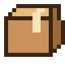 | 📦 | [`package.png`](16px/package.png) | `scripts/icones/art_lieux.py` |
| 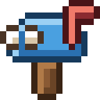 | 📬 | [`open_mailbox_with_raised_flag.png`](16px/open_mailbox_with_raised_flag.png) | `scripts/icones/art_outils.py` |
| 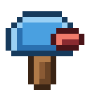 | 📭 | [`open_mailbox_with_lowered_flag.png`](16px/open_mailbox_with_lowered_flag.png) | `scripts/icones/art_outils.py` |
|  | 🔁 | [`clockwise_rightwards_and_leftwards_open_circle_arrows.png`](16px/clockwise_rightwards_and_leftwards_open_circle_arrows.png) | `scripts/icones/art_symboles.py` |
|  | 🔋 | [`battery.png`](16px/battery.png) | `scripts/icones/art_outils.py` |
|  | 🔎 | [`right_pointing_magnifying_glass.png`](16px/right_pointing_magnifying_glass.png) | `scripts/icones/art_symboles.py` |
|  | 🔒 | [`lock.png`](16px/lock.png) | `scripts/icones/art_symboles.py` |
|  | 🔥 | [`fire.png`](16px/fire.png) | `scripts/icones/art_nature.py` |
|  | 🔦 | [`electric_torch.png`](16px/electric_torch.png) | `scripts/icones/art_metaux.py` |
|  | 🔧 | [`wrench.png`](16px/wrench.png) | `scripts/icones/art_outils.py` |
|  | 🔨 | [`hammer.png`](16px/hammer.png) | `scripts/icones/art_atelier.py` |
| 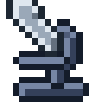 | 🔬 | [`microscope.png`](16px/microscope.png) | `scripts/icones/art_outils.py` |
|  | 🔻 | [`down_pointing_red_triangle.png`](16px/down_pointing_red_triangle.png) | `scripts/icones/art_atelier.py` |
|  | 🕐 | [`clock_face_one_oclock.png`](16px/clock_face_one_oclock.png) | `scripts/icones/art_gens.py` |
|  | 🕑 | [`clock_face_two_oclock.png`](16px/clock_face_two_oclock.png) | `scripts/icones/art_gens.py` |
| 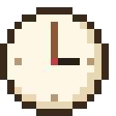 | 🕒 | [`clock_face_three_oclock.png`](16px/clock_face_three_oclock.png) | `scripts/icones/art_gens.py` |
|  | 🕓 | [`clock_face_four_oclock.png`](16px/clock_face_four_oclock.png) | `scripts/icones/art_gens.py` |
|  | 🕔 | [`clock_face_five_oclock.png`](16px/clock_face_five_oclock.png) | `scripts/icones/art_gens.py` |
|  | 🕕 | [`clock_face_six_oclock.png`](16px/clock_face_six_oclock.png) | `scripts/icones/art_gens.py` |
|  | 🕖 | [`clock_face_seven_oclock.png`](16px/clock_face_seven_oclock.png) | `scripts/icones/art_gens.py` |
|  | 🕗 | [`clock_face_eight_oclock.png`](16px/clock_face_eight_oclock.png) | `scripts/icones/art_gens.py` |
|  | 🕘 | [`clock_face_nine_oclock.png`](16px/clock_face_nine_oclock.png) | `scripts/icones/art_gens.py` |
|  | 🕙 | [`clock_face_ten_oclock.png`](16px/clock_face_ten_oclock.png) | `scripts/icones/art_gens.py` |
|  | 🕚 | [`clock_face_eleven_oclock.png`](16px/clock_face_eleven_oclock.png) | `scripts/icones/art_gens.py` |
|  | 🕛 | [`clock_face_twelve_oclock.png`](16px/clock_face_twelve_oclock.png) | `scripts/icones/art_gens.py` |
|  | 🕯 | [`candle.png`](16px/candle.png) | `scripts/icones/art_atelier.py` |
|  | 🕳 | [`hole.png`](16px/hole.png) | `scripts/icones/art_monde.py` |
|  | 🕹 | [`joystick.png`](16px/joystick.png) | `scripts/icones/art_ville.py` |
|  | 🗃 | [`card_file_box.png`](16px/card_file_box.png) | `scripts/icones/art_atelier.py` |
|  | 🗑 | [`wastebasket.png`](16px/wastebasket.png) | `scripts/icones/art_lieux.py` |
|  | 🗺 | [`world_map.png`](16px/world_map.png) | `scripts/icones/art_symboles.py` |
|  | 😊 | [`smiling_face_with_smiling_eyes.png`](16px/smiling_face_with_smiling_eyes.png) | `scripts/icones/art_ville.py` |
|  | 😴 | [`sleeping_face.png`](16px/sleeping_face.png) | `scripts/icones/art_gens.py` |
|  | 🙂 | [`slightly_smiling_face.png`](16px/slightly_smiling_face.png) | `scripts/icones/art_gens.py` |
|  | 🚆 | [`train.png`](16px/train.png) | `scripts/icones/art_ville.py` |
|  | 🚌 | [`bus.png`](16px/bus.png) | `scripts/icones/art_ville.py` |
|  | 🚧 | [`construction_sign.png`](16px/construction_sign.png) | `scripts/icones/art_atelier.py` |
|  | 🚪 | [`door.png`](16px/door.png) | `scripts/icones/art_atelier.py` |
| 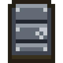 | 🚪‍⬛ | [`door+black_large_square.png`](16px/door+black_large_square.png) | `scripts/icones/art_blocs.py` |
|  | 🚪‍⬜ | [`door+white_large_square.png`](16px/door+white_large_square.png) | `scripts/icones/art_blocs.py` |
| 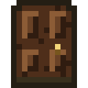 | 🚪‍🟤 | [`door+large_brown_circle.png`](16px/door+large_brown_circle.png) | `scripts/icones/art_blocs.py` |
|  | 🚪‍🟥 | [`door+large_red_square.png`](16px/door+large_red_square.png) | `scripts/icones/art_blocs.py` |
| 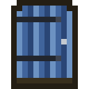 | 🚪‍🟦 | [`door+large_blue_square.png`](16px/door+large_blue_square.png) | `scripts/icones/art_blocs.py` |
|  | 🚪‍🟩 | [`door+large_green_square.png`](16px/door+large_green_square.png) | `scripts/icones/art_blocs.py` |
|  | 🚪‍🪟 | [`door+window.png`](16px/door+window.png) | `scripts/icones/art_blocs.py` |
|  | 🚿 | [`shower.png`](16px/shower.png) | `scripts/icones/art_outils.py` |
|  | 🛏 | [`bed.png`](16px/bed.png) | `scripts/icones/art_atelier.py` |
| 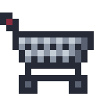 | 🛒 | [`shopping_trolley.png`](16px/shopping_trolley.png) | `scripts/icones/art_lieux.py` |
|  | 🛖 | [`hut.png`](16px/hut.png) | `scripts/icones/art_lieux.py` |
| 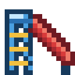 | 🛝 | [`playground_slide.png`](16px/playground_slide.png) | `scripts/icones/art_ville.py` |
| 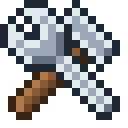 | 🛠 | [`hammer_and_wrench.png`](16px/hammer_and_wrench.png) | `scripts/icones/art_outils.py` |
|  | 🛢 | [`oil_drum.png`](16px/oil_drum.png) | `scripts/icones/art_lieux.py` |
|  | 🛤 | [`railway_track.png`](16px/railway_track.png) | `scripts/icones/art_atelier.py` |
|  | 🛶 | [`canoe.png`](16px/canoe.png) | `scripts/icones/art_atelier.py` |
|  | 🟫‍⚫ | [`large_brown_square+medium_black_circle.png`](16px/large_brown_square+medium_black_circle.png) | `scripts/icones/art_blocs.py` |
|  | 🟫‍⬜ | [`large_brown_square+white_large_square.png`](16px/large_brown_square+white_large_square.png) | `scripts/icones/art_blocs.py` |
|  | 🟫‍🏁 | [`large_brown_square+chequered_flag.png`](16px/large_brown_square+chequered_flag.png) | `scripts/icones/art_blocs.py` |
|  | 🟫‍🔲 | [`large_brown_square+black_square_button.png`](16px/large_brown_square+black_square_button.png) | `scripts/icones/art_blocs.py` |
|  | 🟫‍🟦 | [`large_brown_square+large_blue_square.png`](16px/large_brown_square+large_blue_square.png) | `scripts/icones/art_blocs.py` |
| 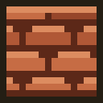 | 🟫‍🟧 | [`large_brown_square+large_orange_square.png`](16px/large_brown_square+large_orange_square.png) | `scripts/icones/art_blocs.py` |
|  | 🟫‍🪚 | [`large_brown_square+carpentry_saw.png`](16px/large_brown_square+carpentry_saw.png) | `scripts/icones/art_atelier.py` |
| 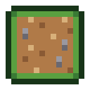 | 🟫‍🪨 | [`large_brown_square+rock.png`](16px/large_brown_square+rock.png) | `scripts/icones/art_atelier.py` |
|  | 🟫‍🪵 | [`large_brown_square+wood.png`](16px/large_brown_square+wood.png) | `scripts/icones/art_blocs.py` |
| 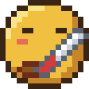 | 🤒 | [`face_with_thermometer.png`](16px/face_with_thermometer.png) | `scripts/icones/art_gens.py` |
|  | 🤖 | [`robot_face.png`](16px/robot_face.png) | `scripts/icones/art_outils.py` |
|  | 🥐 | [`croissant.png`](16px/croissant.png) | `scripts/icones/art_boutiques.py` |
| 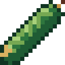 | 🥒 | [`cucumber.png`](16px/cucumber.png) | `assets/crops.png (case 4, 11)` |
|  | 🥔 | [`potato.png`](16px/potato.png) | `scripts/icones/art_recoltes.py` |
| 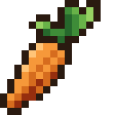 | 🥕 | [`carrot.png`](16px/carrot.png) | `scripts/icones/art_recoltes.py` |
|  | 🥖 | [`baguette_bread.png`](16px/baguette_bread.png) | `scripts/icones/art_cuisine.py` |
|  | 🥗 | [`green_salad.png`](16px/green_salad.png) | `scripts/icones/art_cuisine.py` |
|  | 🥘 | [`shallow_pan_of_food.png`](16px/shallow_pan_of_food.png) | `scripts/icones/art_cuisine.py` |
| 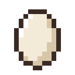 | 🥚 | [`egg.png`](16px/egg.png) | `scripts/icones/art_essai.py` |
|  | 🥛 | [`glass_of_milk.png`](16px/glass_of_milk.png) | `scripts/icones/art_essai.py` |
|  | 🥛‍🏔 | [`glass_of_milk+snow_capped_mountain.png`](16px/glass_of_milk+snow_capped_mountain.png) | `scripts/icones/art_alpage.py` |
|  | 🥣 | [`bowl_with_spoon.png`](16px/bowl_with_spoon.png) | `scripts/icones/art_cuisine.py` |
| 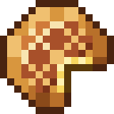 | 🥧 | [`pie.png`](16px/pie.png) | `scripts/icones/art_cuisine.py` |
| 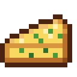 | 🥧‍🥬 | [`pie+leafy_green.png`](16px/pie+leafy_green.png) | `scripts/icones/art_cuisine.py` |
|  | 🥧‍🫐 | [`pie+blueberries.png`](16px/pie+blueberries.png) | `scripts/icones/art_cuisine.py` |
| 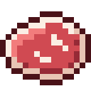 | 🥩 | [`cut_of_meat.png`](16px/cut_of_meat.png) | `scripts/icones/art_cuisine.py` |
|  | 🥫 | [`canned_food.png`](16px/canned_food.png) | `scripts/icones/art_cuisine.py` |
|  | 🥬 | [`leafy_green.png`](16px/leafy_green.png) | `scripts/icones/art_recoltes.py` |
|  | 🥼‍🌱 | [`lab_coat+seedling.png`](16px/lab_coat+seedling.png) | `scripts/icones/art_equipement.py` |
| 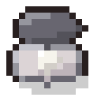 | 🦪 | [`oyster.png`](16px/oyster.png) | `assets/trouvailles.png (case 7, 0)` |
|  | 🧀 | [`cheese_wedge.png`](16px/cheese_wedge.png) | `scripts/icones/art_cuisine.py` |
|  | 🧀‍🥛 | [`cheese_wedge+glass_of_milk.png`](16px/cheese_wedge+glass_of_milk.png) | `scripts/icones/art_cuisine.py` |
|  | 🧄 | [`garlic.png`](16px/garlic.png) | `scripts/icones/art_nature.py` |
|  | 🧅 | [`onion.png`](16px/onion.png) | `scripts/icones/art_recoltes.py` |
|  | 🧈‍⚪ | [`butter+medium_white_circle.png`](16px/butter+medium_white_circle.png) | `scripts/icones/art_metaux.py` |
|  | 🧈‍🔩 | [`butter+nut_and_bolt.png`](16px/butter+nut_and_bolt.png) | `scripts/icones/art_metaux.py` |
|  | 🧈‍🟠 | [`butter+large_orange_circle.png`](16px/butter+large_orange_circle.png) | `scripts/icones/art_metaux.py` |
| 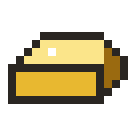 | 🧈‍🟡 | [`butter+large_yellow_circle.png`](16px/butter+large_yellow_circle.png) | `scripts/icones/art_metaux.py` |
|  | 🧊 | [`ice_cube.png`](16px/ice_cube.png) | `scripts/icones/art_nature.py` |
|  | 🧤‍🟫 | [`gloves+large_brown_square.png`](16px/gloves+large_brown_square.png) | `scripts/icones/art_equipement.py` |
|  | 🧥‍❄ | [`coat+snowflake.png`](16px/coat+snowflake.png) | `scripts/icones/art_equipement.py` |
|  | 🧪 | [`test_tube.png`](16px/test_tube.png) | `scripts/icones/art_outils.py` |
|  | 🧭 | [`compass.png`](16px/compass.png) | `scripts/icones/art_monde.py` |
|  | 🧰 | [`toolbox.png`](16px/toolbox.png) | `scripts/icones/art_outils.py` |
|  | 🧱 | [`brick.png`](16px/brick.png) | `scripts/icones/art_atelier.py` |
|  | 🧱‍⬜ | [`brick+white_large_square.png`](16px/brick+white_large_square.png) | `scripts/icones/art_blocs.py` |
|  | 🧱‍📐 | [`brick+triangular_ruler.png`](16px/brick+triangular_ruler.png) | `scripts/icones/art_blocs.py` |
|  | 🧱‍🟥 | [`brick+large_red_square.png`](16px/brick+large_red_square.png) | `scripts/icones/art_blocs.py` |
|  | 🧱‍🟦 | [`brick+large_blue_square.png`](16px/brick+large_blue_square.png) | `scripts/icones/art_blocs.py` |
|  | 🧱‍🟧 | [`brick+large_orange_square.png`](16px/brick+large_orange_square.png) | `scripts/icones/art_blocs.py` |
|  | 🧱‍🟨 | [`brick+large_yellow_square.png`](16px/brick+large_yellow_square.png) | `scripts/icones/art_blocs.py` |
|  | 🧱‍🟫 | [`brick+large_brown_square.png`](16px/brick+large_brown_square.png) | `scripts/icones/art_blocs.py` |
|  | 🧱‍🪟 | [`brick+window.png`](16px/brick+window.png) | `scripts/icones/art_blocs.py` |
|  | 🧱‍🪨 | [`brick+rock.png`](16px/brick+rock.png) | `scripts/icones/art_blocs.py` |
|  | 🧱‍🪵 | [`brick+wood.png`](16px/brick+wood.png) | `scripts/icones/art_atelier.py` |
|  | 🧶 | [`ball_of_yarn.png`](16px/ball_of_yarn.png) | `scripts/icones/art_lieux.py` |
|  | 🧺 | [`basket.png`](16px/basket.png) | `scripts/icones/art_lieux.py` |
|  | 🪓 | [`axe.png`](16px/axe.png) | `scripts/icones/art_outils.py` |
|  | 🪚 | [`carpentry_saw.png`](16px/carpentry_saw.png) | `scripts/icones/art_atelier.py` |
|  | 🪜 | [`ladder.png`](16px/ladder.png) | `scripts/icones/art_blocs.py` |
|  | 🪟 | [`window.png`](16px/window.png) | `scripts/icones/art_blocs.py` |
|  | 🪟‍⭕ | [`window+heavy_large_circle.png`](16px/window+heavy_large_circle.png) | `scripts/icones/art_blocs.py` |
|  | 🪟‍🌈 | [`window+rainbow.png`](16px/window+rainbow.png) | `scripts/icones/art_blocs.py` |
|  | 🪟‍🌙 | [`window+crescent_moon.png`](16px/window+crescent_moon.png) | `scripts/icones/art_blocs.py` |
|  | 🪟‍🟩 | [`window+large_green_square.png`](16px/window+large_green_square.png) | `scripts/icones/art_blocs.py` |
|  | 🪢 | [`knot.png`](16px/knot.png) | `scripts/icones/art_atelier.py` |
|  | 🪣 | [`bucket.png`](16px/bucket.png) | `scripts/icones/art_lieux.py` |
|  | 🪨 | [`rock.png`](16px/rock.png) | `scripts/icones/art_nature.py` |
|  | 🪨‍⚙ | [`rock+gear.png`](16px/rock+gear.png) | `scripts/icones/art_atelier.py` |
|  | 🪨‍⚪ | [`rock+medium_white_circle.png`](16px/rock+medium_white_circle.png) | `scripts/icones/art_metaux.py` |
|  | 🪨‍🐚 | [`rock+spiral_shell.png`](16px/rock+spiral_shell.png) | `assets/trouvailles.png (case 0, 0)` |
|  | 🪨‍🔩 | [`rock+nut_and_bolt.png`](16px/rock+nut_and_bolt.png) | `scripts/icones/art_metaux.py` |
|  | 🪨‍🟠 | [`rock+large_orange_circle.png`](16px/rock+large_orange_circle.png) | `scripts/icones/art_metaux.py` |
|  | 🪨‍🟡 | [`rock+large_yellow_circle.png`](16px/rock+large_yellow_circle.png) | `scripts/icones/art_metaux.py` |
|  | 🪨‍🪲 | [`rock+beetle.png`](16px/rock+beetle.png) | `assets/trouvailles.png (case 1, 0)` |
|  | 🪴 | [`potted_plant.png`](16px/potted_plant.png) | `scripts/icones/art_nature.py` |
|  | 🪴‍🌷 | [`potted_plant+tulip.png`](16px/potted_plant+tulip.png) | `scripts/icones/art_ruche.py` |
|  | 🪵 | [`wood.png`](16px/wood.png) | `scripts/icones/art_nature.py` |
|  | 🪵‍🌈 | [`wood+rainbow.png`](16px/wood+rainbow.png) | `scripts/icones/art_atelier.py` |
|  | 🪵‍🔗 | [`wood+link_symbol.png`](16px/wood+link_symbol.png) | `scripts/icones/art_cheval.py` |
|  | 🪸 | [`coral.png`](16px/coral.png) | `assets/trouvailles.png (case 6, 0)` |
|  | 🪹 | [`empty_nest.png`](16px/empty_nest.png) | `scripts/icones/art_nature.py` |
|  | 🪺 | [`nest_with_eggs.png`](16px/nest_with_eggs.png) | `scripts/icones/art_atelier.py` |
|  | 🫐 | [`blueberries.png`](16px/blueberries.png) | `scripts/icones/art_ville.py` |
|  | 🫐‍⚫ | [`blueberries+medium_black_circle.png`](16px/blueberries+medium_black_circle.png) | `scripts/icones/art_nature.py` |
|  | 🫑 | [`bell_pepper.png`](16px/bell_pepper.png) | `scripts/icones/art_recoltes.py` |
|  | 🫕 | [`fondue.png`](16px/fondue.png) | `scripts/icones/art_ville.py` |
|  | 🫘 | [`beans.png`](16px/beans.png) | `scripts/icones/art_nature.py` |
|  | 🫙 | [`jar.png`](16px/jar.png) | `scripts/icones/art_cuisine.py` |
|  | 🫙‍🌰 | [`jar+chestnut.png`](16px/jar+chestnut.png) | `scripts/icones/art_cuisine.py` |
|  | 🫙‍🍓 | [`jar+strawberry.png`](16px/jar+strawberry.png) | `scripts/icones/art_cuisine.py` |
|  | 🫙‍🥚 | [`jar+egg.png`](16px/jar+egg.png) | `scripts/icones/art_cuisine.py` |

## Dessins de 32×32 (35)

| Dessin | Fichier |
|:---:|---|
|  | [`axe-btn.png`](dessins/axe-btn.png) |
|  | [`b-batterie.png`](dessins/b-batterie.png) |
|  | [`b-champ.png`](dessins/b-champ.png) |
|  | [`b-cuisine.png`](dessins/b-cuisine.png) |
|  | [`b-four.png`](dessins/b-four.png) |
|  | [`b-frigo.png`](dessins/b-frigo.png) |
|  | [`b-moulin.png`](dessins/b-moulin.png) |
|  | [`b-panneau.png`](dessins/b-panneau.png) |
|  | [`b-paturage.png`](dessins/b-paturage.png) |
|  | [`b-pompe.png`](dessins/b-pompe.png) |
|  | [`b-potager.png`](dessins/b-potager.png) |
|  | [`b-poulailler.png`](dessins/b-poulailler.png) |
|  | [`b-presse.png`](dessins/b-presse.png) |
|  | [`b-reservoir.png`](dessins/b-reservoir.png) |
|  | [`b-serre.png`](dessins/b-serre.png) |
|  | [`b-silo.png`](dessins/b-silo.png) |
|  | [`b-verger.png`](dessins/b-verger.png) |
|  | [`carte-panneau_ville.png`](dessins/carte-panneau_ville.png) |
|  | [`cow.png`](dessins/cow.png) |
|  | [`egg.png`](dessins/egg.png) |
|  | [`hen.png`](dessins/hen.png) |
|  | [`hoe-btn.png`](dessins/hoe-btn.png) |
|  | [`pick-btn.png`](dessins/pick-btn.png) |
|  | [`plot-soil.png`](dessins/plot-soil.png) |
|  | [`sheep-shorn.png`](dessins/sheep-shorn.png) |
|  | [`sheep-wool.png`](dessins/sheep-wool.png) |
|  | [`sleep-off.png`](dessins/sleep-off.png) |
|  | [`sleep-on.png`](dessins/sleep-on.png) |
|  | [`tree-abricotier.png`](dessins/tree-abricotier.png) |
|  | [`tree-adult.png`](dessins/tree-adult.png) |
|  | [`tree-cerisier.png`](dessins/tree-cerisier.png) |
|  | [`tree-pecher.png`](dessins/tree-pecher.png) |
|  | [`tree-poirier.png`](dessins/tree-poirier.png) |
|  | [`tree-pommier.png`](dessins/tree-pommier.png) |
|  | [`tree-young.png`](dessins/tree-young.png) |
